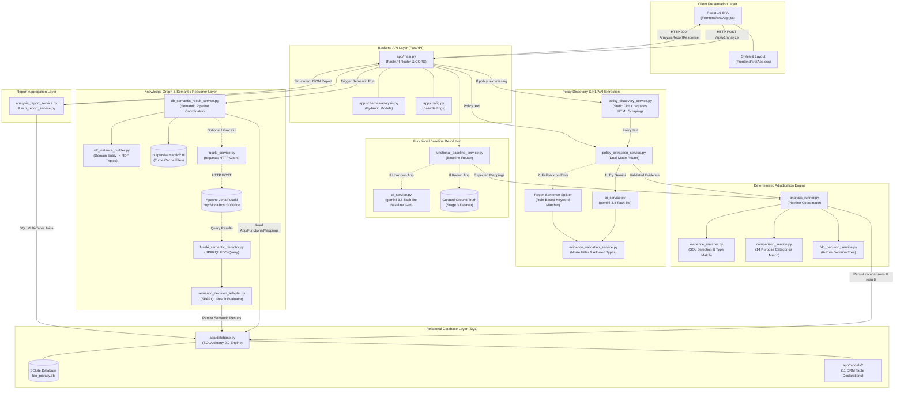

# FDO Privacy Project: Part 1 - Repository Inventory & Architecture Audit

**Project Path:** `C:\FDO`  
**Audit Type:** Read-Only Static and Structural Audit for IDF-B Preparation  
**Timestamp:** 2026-10-13  
**Auditor Status:** Automated Assistant (Strict Read-Only Mode)

---

## 1. Executive Summary & Audit Methodology

This report establishes the baseline technical and architectural inventory for the **FDO Privacy Project** (Functional Data Ontology). Every finding, assertion, and connection in this document is derived strictly from inspected source code, configuration files, and datasets present in `C:\FDO`. 

### Evaluation Status Taxonomy (Rule 3)
- **Implemented-verified**: Feature is fully coded and validated via test executions, output artifacts, or verifiable operational code paths.
- **Implemented-not-run**: Feature is fully coded but has not been executed in the current audit session or lacks runtime execution in this environment.
- **Partial**: Feature code exists but depends on uninstalled packages, incomplete stubbing, or missing endpoints.
- **Prototype**: Experimental or transitional script/class designed for proof-of-concept testing.
- **Configured-but-unused**: Library, setting, or file is declared in configuration or filesystem but unreferenced by active execution pathways.
- **Planned-only**: Mentioned in specification documents or comments but has no underlying implementation code.
- **Not-found**: Claimed capability or dependency completely absent from the codebase.

---

## 2. Repository Inventory Table

| Path | Type | Purpose | Techniques Used | Inputs | Outputs | Connected Files | Status | Evidence |
| :--- | :--- | :--- | :--- | :--- | :--- | :--- | :--- | :--- |
| `Backend/app/main.py` | Python Script (FastAPI) | Primary REST API entrypoint exposing endpoints for application ingestion, policy extraction, analysis execution, and report delivery | FastAPI routing, CORS middleware (`CORSMiddleware`), dependency injection (`Depends(get_db)`), SQLite schema compatibility check | HTTP JSON Requests (`AnalyzeRequest`, `PolicyExtractionRequest`) | HTTP JSON Responses (`AnalysisReportResponse`, `RichAnalysisReportResponse`, etc.) | `Backend/app/config.py`, `Backend/app/database.py`, `Backend/app/services/*`, `Backend/app/ontology/*` | Implemented-verified | `Backend/app/main.py:86-620` |
| `Backend/app/config.py` | Python Script (Pydantic) | Central application settings management | Pydantic Settings (`BaseSettings`, `SettingsConfigDict`), `.env` parsing | `.env` file | `Settings` singleton instance | `Backend/app/main.py`, `Backend/app/database.py` | Implemented-verified | `Backend/app/config.py:4-17` |
| `Backend/app/database.py` | Python Script (SQLAlchemy) | Database engine creation, session factory, and SQLite compatibility migrations | SQLAlchemy 2.0 `create_engine`, `sessionmaker`, raw SQL `PRAGMA` execution via `text()` | SQLite DB file (`fdo_privacy.db`) | SQLAlchemy `SessionLocal`, DB engine | `Backend/app/config.py`, `Backend/app/models/*`, `Backend/app/main.py` | Implemented-verified | `Backend/app/database.py:8-54` |
| `Backend/app/init_db.py` | Python Script | Standalone table initializer script | `Base.metadata.create_all`, schema migration call | SQLAlchemy Engine | SQLite table schemas in `fdo_privacy.db` | `Backend/app/database.py`, `Backend/app/models/base.py` | Prototype / Standalone | `Backend/app/init_db.py:6-13` |
| `Backend/app/models/base.py` | Python Script (SQLAlchemy) | Declarative base class for ORM models | SQLAlchemy `DeclarativeBase` | None | `Base` declarative class | All ORM models in `Backend/app/models/` | Implemented-verified | `Backend/app/models/base.py:4-5` |
| `Backend/app/models/application.py` | Python Script (ORM) | Data model for evaluated mobile/web applications | SQLAlchemy `Column`, `String`, `Text`, `DateTime` | ORM operations | `applications` table schema | `Backend/app/models/__init__.py`, `Backend/app/services/application_service.py` | Implemented-verified | `Backend/app/models/application.py:9-25` |
| `Backend/app/models/function.py` | Python Script (ORM) | Data model for functional features of applications | SQLAlchemy `Column`, `ForeignKey("applications.application_id")` | ORM operations | `functions` table schema | `Backend/app/models/application.py`, `Backend/app/services/function_service.py` | Implemented-verified | `Backend/app/models/function.py:9-29` |
| `Backend/app/models/expected_mapping.py` | Python Script (ORM) | Expected functional data requirements per function | SQLAlchemy `Column`, `ForeignKey("functions.id")`, necessity levels | ORM operations | `expected_mappings` table schema | `Backend/app/models/function.py`, `Backend/app/services/expected_mapping_service.py` | Implemented-verified | `Backend/app/models/expected_mapping.py:9-36` |
| `Backend/app/models/policy_document.py` | Python Script (ORM) | Metadata and raw text for ingested privacy policies | SQLAlchemy `Column`, `ForeignKey("applications.application_id")` | ORM operations | `policy_documents` table schema | `Backend/app/models/application.py`, `Backend/app/services/policy_service.py` | Implemented-verified | `Backend/app/models/policy_document.py:9-33` |
| `Backend/app/models/policy_evidence.py` | Python Script (ORM) | Extracted policy disclosure clauses and quotes | SQLAlchemy `Column`, `ForeignKey("policy_documents.policy_id")` | ORM operations | `policy_evidence` table schema | `Backend/app/models/policy_document.py`, `Backend/app/services/evidence_service.py` | Implemented-verified | `Backend/app/models/policy_evidence.py:9-41` |
| `Backend/app/models/normalized_evidence.py` | Python Script (ORM) | Normalized representation of extracted policy evidence | SQLAlchemy `Column`, `ForeignKey("policy_evidence.evidence_id")` | ORM operations | `normalized_evidence` table schema | `Backend/app/models/policy_evidence.py` | Implemented-not-run | `Backend/app/models/normalized_evidence.py:9-28` |
| `Backend/app/models/analysis.py` | Python Script (ORM) | Analysis execution run header and status tracking | SQLAlchemy `Column`, `ForeignKey("applications.application_id")` | ORM operations | `analyses` table schema | `Backend/app/models/application.py`, `Backend/app/services/analysis_service.py` | Implemented-verified | `Backend/app/models/analysis.py:9-36` |
| `Backend/app/models/comparison.py` | Python Script (ORM) | Pairwise comparison between expected data and declared evidence | SQLAlchemy `Column`, `ForeignKey` to analysis, expected mapping, evidence | ORM operations | `comparisons` table schema | `Backend/app/services/comparison_service.py` | Implemented-verified | `Backend/app/models/comparison.py:9-39` |
| `Backend/app/models/fdo_result.py` | Python Script (ORM) | Adjudicated baseline FDO classification result | SQLAlchemy `Column`, `ForeignKey("comparisons.comparison_id")`, status enums | ORM operations | `fdo_results` table schema | `Backend/app/services/fdo_decision_service.py` | Implemented-verified | `Backend/app/models/fdo_result.py:9-27` |
| `Backend/app/models/explanation.py` | Python Script (ORM) | Natural language and structured decision explanation | SQLAlchemy `Column`, `ForeignKey("fdo_results.result_id")` | ORM operations | `explanations` table schema | `Backend/app/services/explanation_service.py` | Implemented-verified | `Backend/app/models/explanation.py:9-26` |
| `Backend/app/models/semantic_fdo_result.py` | Python Script (ORM) | Ontology/SPARQL-derived FDO detection findings | SQLAlchemy `Column`, `ForeignKey("analyses.analysis_id")`, rule tracking | ORM operations | `semantic_fdo_results` table schema | `Backend/app/ontology/semantic_result_repository.py` | Implemented-verified | `Backend/app/models/semantic_fdo_result.py:9-52` |
| `Backend/app/schemas/analysis.py` | Python Script (Pydantic) | Pydantic data schemas for request validation and response serialization | Pydantic `BaseModel`, `Field`, `ConfigDict(from_attributes=True)` | JSON payload dicts | Serialized Pydantic models | `Backend/app/main.py` | Implemented-verified | `Backend/app/schemas/analysis.py:8-232` |
| `Backend/app/schemas/analysis_result.py` | Python Script (Pydantic) | Flat result view schemas | Pydantic `BaseModel` | ORM objects | Serialized result objects | `Backend/app/main.py:31` | Implemented-verified | `Backend/app/schemas/analysis_result.py:4-21` |
| `Backend/app/schemas/policy_extraction.py` | Python Script (Pydantic) | Policy extraction request/response schemas | Pydantic `BaseModel` | Policy extraction text | Serialized extraction evidence | `Backend/app/main.py:47-51` | Implemented-verified | `Backend/app/schemas/policy_extraction.py:4-20` |
| `Backend/app/schemas/rich_report.py` | Python Script (Pydantic) | Comprehensive reporting schema with comparisons, evidence, and semantic results | Pydantic `BaseModel`, nested models | Database joined query results | Detailed structured report payload | `Backend/app/main.py:52-54` | Implemented-verified | `Backend/app/schemas/rich_report.py:7-108` |
| `Backend/app/services/ai_service.py` | Python Script | Integration with Google Gemini for policy evidence extraction and baseline generation | Google GenAI SDK (`google.genai.Client`), Prompt Engineering, JSON validation | Raw policy text, App category/description | Extracted structured evidence dicts, Functional baseline dicts | `Backend/app/services/policy_extraction_service.py`, `functional_baseline_service.py` | Implemented-verified | `Backend/app/services/ai_service.py:6-440` |
| `Backend/app/services/policy_discovery_service.py` | Python Script | Policy URL lookup and web content retrieval | Static URL dictionary (`KNOWN_POLICY_URLS`), `requests.get()`, `html.parser.HTMLParser` text stripping | App name string | `PolicyDiscoveryResult` (extracted policy text, source URL) | `Backend/app/main.py:58-60` | Implemented-verified | `Backend/app/services/policy_discovery_service.py:10-221` |
| `Backend/app/services/policy_extraction_service.py` | Python Script | Dual-mode policy extraction orchestrator (LLM primary, regex fallback) | Regex sentence splitting (`re.split`), keyword matching, AI extraction invocation | Policy text, app name | List of validated evidence dicts | `Backend/app/services/ai_service.py`, `evidence_validation_service.py` | Implemented-verified | `Backend/app/services/policy_extraction_service.py:8-91` |
| `Backend/app/services/evidence_validation_service.py` | Python Script | Cleanses, normalizes, and filters hallucinated/noisy evidence | Keyword filtering (`PRIVACY_DATA_KEYWORDS`, `PROCESSING_KEYWORDS`, `OPERATIONAL_NOISE`), regex normalization | Raw extracted evidence dicts | Validated and normalized evidence dicts | `Backend/app/services/policy_extraction_service.py` | Implemented-verified | `Backend/app/services/evidence_validation_service.py:4-265` |
| `Backend/app/services/functional_baseline_service.py` | Python Script | Resolves or dynamically generates expected functional data baselines | SHA1 hashing (`_stable_suffix`), slug generation, Gemini baseline fallback, DB persistence | Application ORM object | `BaselineGenerationResult` | `Backend/app/services/ai_service.py`, `Backend/app/main.py:61-63` | Implemented-verified | `Backend/app/services/functional_baseline_service.py:22-389` |
| `Backend/app/services/comparison_service.py` | Python Script | Evaluates alignment between expected data needs and declared policy evidence | Deterministic taxonomic matching (`PURPOSE_CATEGORIES`, 14 classes), string normalization | `ComparisonInput` | `ComparisonOutput` (`data_match`, `purpose_compatibility`, etc.) | `Backend/app/services/analysis_runner.py` | Implemented-verified | `Backend/app/services/comparison_service.py:3-481` |
| `Backend/app/services/evidence_matcher.py` | Python Script | Matches declared evidence items to expected functional data needs | SQL queries, purpose compatibility evaluation, contextual text search | Session, policy ID, ExpectedMapping | `EvidenceMatch` | `Backend/app/services/analysis_runner.py` | Implemented-verified | `Backend/app/services/evidence_matcher.py:14-193` |
| `Backend/app/services/fdo_decision_service.py` | Python Script | Deterministic decision engine adjudicating FDO status | Rule-based decision tree (6 rules: No Evidence, Insufficient, Compatible, Incompatible, Mismatch, Fallback) | `FDODecisionInput` | `FDODecisionOutput` (status: FDO, NOT_FDO, AMBIGUOUS, confidence: float, reason: str) | `Backend/app/services/analysis_runner.py` | Implemented-verified | `Backend/app/services/fdo_decision_service.py:27-147` |
| `Backend/app/services/analysis_runner.py` | Python Script | Executes the end-to-end deterministic analysis pipeline for an application | Orchestrates DB queries, evidence matching, comparison evaluation, FDO decision, and explanations | DB Session, analysis ID, app ID, policy ID | None (persists records in DB) | `Backend/app/main.py:35`, `Backend/app/services/*` | Implemented-verified | `Backend/app/services/analysis_runner.py:25-257` |
| `Backend/app/services/analysis_report_service.py` | Python Script | Aggregates database analysis entities into response reporting structures | SQLAlchemy queries with joins, counter aggregations | DB Session, analysis ID | `AnalysisReportResponse` internal model | `Backend/app/main.py:12` | Implemented-verified | `Backend/app/services/analysis_report_service.py:24-122` |
| `Backend/app/services/rich_report_service.py` | Python Script | Constructs enriched analytical report joining comparisons, evidence, and semantic findings | Complex multi-table outer join queries via SQLAlchemy | DB Session, analysis ID | Dict conforming to `RichAnalysisReportResponse` | `Backend/app/main.py:16-18` | Implemented-verified | `Backend/app/services/rich_report_service.py:17-250` |
| `Backend/app/services/application_service.py` | Python Script | CRUD and readiness inspection for applications | SQLAlchemy queries, UUID generation | DB Session, app ID / name | Application ORM object, readiness dict | `Backend/app/main.py:22-27` | Implemented-verified | `Backend/app/services/application_service.py:16-125` |
| `Backend/app/services/function_service.py` | Python Script | Queries application functions | SQLAlchemy `select` | DB Session, app ID | List of Function ORM objects | `Backend/app/main.py:28-30` | Implemented-verified | `Backend/app/services/function_service.py:7-24` |
| `Backend/app/services/expected_mapping_service.py` | Python Script | Queries expected mappings | SQLAlchemy `select` | DB Session, app ID | List of ExpectedMapping ORM objects | `Backend/app/main.py:65-68` | Implemented-verified | `Backend/app/services/expected_mapping_service.py:8-38` |
| `Backend/app/services/policy_ingestion_service.py` | Python Script | Stores runtime policies and evidence items in SQL DB | DB transaction persistence, UUID generation | DB Session, policy text, evidence list | PolicyDocument ORM object | `Backend/app/main.py:19-21` | Implemented-verified | `Backend/app/services/policy_ingestion_service.py:16-62` |
| `Backend/app/services/policy_service.py` | Python Script | Queries policy documents | SQLAlchemy `get` / `select` | DB Session, policy ID | PolicyDocument ORM object | `Backend/app/main.py` | Implemented-verified | `Backend/app/services/policy_service.py:7-26` |
| `Backend/app/services/evidence_service.py` | Python Script | Queries policy evidence records | SQLAlchemy `select` | DB Session, policy ID | List of PolicyEvidence ORM objects | `Backend/scripts/persist_fdo_test.py` | Implemented-verified | `Backend/app/services/evidence_service.py:7-35` |
| `Backend/app/services/comparison_persistence_service.py` | Python Script | Persists comparison outputs | SQLAlchemy model instantiation | DB Session, ComparisonOutput | Comparison ORM object | `Backend/app/services/analysis_runner.py` | Implemented-verified | `Backend/app/services/comparison_persistence_service.py:8-30` |
| `Backend/app/services/explanation_service.py` | Python Script | Persists decision explanation text | SQLAlchemy model instantiation | DB Session, result ID, text | Explanation ORM object | `Backend/app/services/analysis_runner.py` | Implemented-verified | `Backend/app/services/explanation_service.py:8-28` |
| `Backend/app/services/result_service.py` | Python Script | Persists adjudicated FDO result | SQLAlchemy model instantiation | DB Session, FDODecisionOutput | FDOResult ORM object | `Backend/app/services/analysis_runner.py` | Implemented-verified | `Backend/app/services/result_service.py:8-25` |
| `Backend/app/services/policy_analysis_service.py` | Python Script | Computes policy evidence summary metrics (total disclosures, tracking, sharing) | Aggregation counters over evidence list | List of PolicyEvidence | Summary dict | `Backend/app/services/analysis_report_service.py` | Implemented-verified | `Backend/app/services/policy_analysis_service.py:8-109` |
| `Backend/app/ontology/namespace.py` | Python Script (RDF) | Defines RDF namespace for FDO (`http://example.org/fdo#`) | RDFLib `Namespace` | None | `FDO` Namespace, `FDO_NAMESPACE_URI` | All ontology modules in `Backend/app/ontology/` | Partial (rdflib uninstalled in venv) | `Backend/app/ontology/namespace.py:8-13` |
| `Backend/app/ontology/classes.py` | Python Script | Python domain classes for FDO ontology concepts (19 classes) | Python `@dataclass` | Entity parameters | Domain data class instances | `Backend/app/ontology/specification.py`, `rdf_instance_builder.py` | Implemented-verified | `Backend/app/ontology/classes.py:40-386` |
| `Backend/app/ontology/properties.py` | Python Script | Object property specifications for FDO ontology | Python `@dataclass` | Domain, range, inverse specifications | Property definition objects | `Backend/app/ontology/specification.py` | Implemented-verified | `Backend/app/ontology/properties.py:27-241` |
| `Backend/app/ontology/data_properties.py` | Python Script | Datatype property specifications for FDO ontology | Python `@dataclass` | Domain, XSD datatype specifications | Data property definition objects | `Backend/app/ontology/specification.py` | Implemented-verified | `Backend/app/ontology/data_properties.py:27-208` |
| `Backend/app/ontology/constraints.py` | Python Script | Cardinality and semantic constraint rules | Python `@dataclass` | Constraint specifications | Constraint definition objects | `Backend/app/ontology/specification.py` | Implemented-verified | `Backend/app/ontology/constraints.py:28-216` |
| `Backend/app/ontology/specification.py` | Python Script | Aggregates all classes, properties, and constraints into master specification | Python dictionary aggregation | Ontology modules | Complete specification dictionary | `Backend/app/ontology/owl_builder.py` | Implemented-verified | `Backend/app/ontology/specification.py:16-107` |
| `Backend/app/ontology/competency_questions.py` | Python Script | Competency questions driving ontology design | Python dictionary structures | Natural language CQs | Formal CQ registry | Tests | Implemented-verified | `Backend/app/ontology/competency_questions.py:20-255` |
| `Backend/app/ontology/uri.py` | Python Script | Deterministic URI generation for ontology instances | `urllib.parse.quote`, RDFLib `URIRef` | Entity IDs | Formatted `URIRef` instances | `Backend/app/ontology/rdf_instance_builder.py` | Partial (rdflib uninstalled in venv) | `Backend/app/ontology/uri.py:27-99` |
| `Backend/app/ontology/owl_builder.py` | Python Script (OWL) | Builds OWL ontology RDFLib graph and serializes to XML/Turtle | RDFLib `Graph`, `OWL`, `RDFS`, `RDF`, `XSD` triples | Specification dictionary | In-memory `Graph` or serialized file | `Backend/scripts/generate_fdo_ontology.py` | Partial (rdflib uninstalled in venv) | `Backend/app/ontology/owl_builder.py:28-252` |
| `Backend/app/ontology/rdf_instance_builder.py` | Python Script (RDF) | Transforms domain entity objects into RDF individuals and relationships | RDFLib triple generation (`graph.add`) | Domain entity objects | Populated RDFLib `Graph` | `Backend/app/ontology/db_rdf_mapper.py` | Partial (rdflib uninstalled in venv) | `Backend/app/ontology/rdf_instance_builder.py:65-1047` |
| `Backend/app/ontology/db_rdf_mapper.py` | Python Script | Maps SQLAlchemy ORM records to ontology domain objects | Data normalization, type mapping | ORM records | Domain entity objects | `Backend/app/ontology/db_rdf_service.py` | Implemented-verified | `Backend/app/ontology/db_rdf_mapper.py:20-80` |
| `Backend/app/ontology/db_rdf_service.py` | Python Script | Orchestrates DB-to-RDF graph transformation | Combines `DBRDFMapper`, `RDFInstanceBuilder`, and ontology schema | ORM records | Complete RDFLib `Graph` | `Backend/app/ontology/db_semantic_result_service.py` | Partial (rdflib uninstalled in venv) | `Backend/app/ontology/db_rdf_service.py:13-74` |
| `Backend/app/ontology/rdf_export_service.py` | Python Script | Exports RDF graphs to file formats (TTL, XML) | RDFLib `graph.serialize` | RDFLib Graph, file path | Serialized RDF file on disk | `Backend/scripts/export_fdo_test_graph.py` | Partial (rdflib uninstalled in venv) | `Backend/app/ontology/rdf_export_service.py:11-30` |
| `Backend/app/ontology/fdo_detection_queries.py` | Python Script (SPARQL) | Core SPARQL query strings for detecting semantic FDO overreach | SPARQL `SELECT`, `FILTER` conditions | RDF Graph | SPARQL Query Strings | `Backend/app/ontology/fdo_semantic_detector.py` | Implemented-verified | `Backend/app/ontology/fdo_detection_queries.py:5-54` |
| `Backend/app/ontology/fdo_semantic_detector.py` | Python Script (SPARQL) | Runs in-memory SPARQL queries against local RDFLib graph | RDFLib `graph.query()` | RDFLib `Graph` | List of finding dicts | `Backend/scripts/verify_fdo_decision.py` | Partial (rdflib uninstalled in venv) | `Backend/app/ontology/fdo_semantic_detector.py:34-107` |
| `Backend/app/ontology/fuseki_service.py` | Python Script (HTTP) | Client for Apache Jena Fuseki SPARQL triple store | HTTP requests via `requests` (`POST` to `/query`, `/update`, `/data`) | SPARQL strings, Turtle files | SPARQL JSON results | `Backend/app/ontology/fuseki_semantic_detector.py` | Implemented-verified | `Backend/app/ontology/fuseki_service.py:6-69` |
| `Backend/app/ontology/fuseki_semantic_detector.py` | Python Script (SPARQL) | Executes FDO detection queries against remote Fuseki SPARQL endpoint | SPARQL queries over HTTP | Fuseki endpoint | List of finding dicts | `Backend/app/ontology/db_semantic_result_service.py` | Implemented-verified | `Backend/app/ontology/fuseki_semantic_detector.py:9-52` |
| `Backend/app/ontology/fuseki_decision_service.py` | Python Script | High-level decision service over Fuseki detector | Detection query execution, finding synthesis | Fuseki service | High-level FDO findings | Tests | Implemented-verified | `Backend/app/ontology/fuseki_decision_service.py:8-33` |
| `Backend/app/ontology/semantic_fuseki_service.py` | Python Script | Publishes RDF graph to disk and Fuseki triple store | Turtle serialization, Fuseki HTTP upload | RDFLib Graph, output path | Saved `.ttl` file, updated Fuseki graph | `Backend/app/ontology/db_semantic_result_service.py` | Partial (rdflib uninstalled in venv) | `Backend/app/ontology/semantic_fuseki_service.py:10-38` |
| `Backend/app/ontology/semantic_decision_adapter.py` | Python Script | Adjudicates semantic findings into structured decision results | Heuristic status mapping, reason text generation | SPARQL finding dict | Adjudicated semantic result dict | `Backend/app/ontology/db_semantic_result_service.py` | Implemented-verified | `Backend/app/ontology/semantic_decision_adapter.py:7-78` |
| `Backend/app/ontology/db_semantic_repository.py` | Python Script | Data access layer querying ORM records needed for RDF transformation | SQLAlchemy queries | DB Session | ORM record collections | `Backend/app/ontology/db_semantic_result_service.py` | Implemented-verified | `Backend/app/ontology/db_semantic_repository.py:10-72` |
| `Backend/app/ontology/semantic_result_repository.py` | Python Script | Persists and retrieves semantic FDO results in relational database | SQLAlchemy ORM operations on `SemanticFDOResult` | Analysis ID, result dicts | `SemanticFDOResult` ORM objects | `Backend/app/main.py:407-417` | Implemented-verified | `Backend/app/ontology/semantic_result_repository.py:10-68` |
| `Backend/app/ontology/db_semantic_result_service.py` | Python Script | End-to-end coordinator for database-driven semantic analysis | RDF graph generation, Fuseki publishing, SPARQL detection, deduplication, purpose grouping | App ID, policy ID, output path | List of semantic result dicts | `Backend/app/main.py:392-405` | Partial (rdflib uninstalled in venv) | `Backend/app/ontology/db_semantic_result_service.py:131-253` |
| `Backend/app/ontology/semantic_explanation_service.py` | Python Script | Generates human-readable explanations for semantic FDO decisions | Template-based string formatting | Semantic result record | Explanation string | `Backend/app/services/rich_report_service.py` | Implemented-verified | `Backend/app/ontology/semantic_explanation_service.py:6-45` |
| `Backend/app/ontology/sparql_queries.py` | Python Script | Generic competency query collection | SPARQL query definitions | None | SPARQL query constants | Tests | Implemented-verified | `Backend/app/ontology/sparql_queries.py:5-48` |
| `Backend/app/ontology/sparql_service.py` | Python Script | Wrapper for local RDFLib SPARQL execution | RDFLib graph query | SPARQL string | Query result bindings | Tests | Partial (rdflib uninstalled in venv) | `Backend/app/ontology/sparql_service.py:7-27` |
| `Backend/ontology/FDO.owl` | OWL/RDF XML Document | Serialized OWL ontology definition containing all 19 classes, object/data properties | W3C OWL/RDF XML standard | Generated by `generate_fdo_ontology.py` | Ontology schema definition for reasoners | Apache Jena Fuseki, Protege | Implemented-verified | `Backend/ontology/FDO.owl:1-436` |
| `Backend/ontology/fdo-semantic-fixture.ttl` | Turtle RDF Document | Test fixture graph containing sample application and declared data | W3C Turtle syntax | Hand-crafted/exported test triples | Test graph for Fuseki tests | `Backend/test_fuseki_fixture.py` | Implemented-verified | `Backend/ontology/fdo-semantic-fixture.ttl:1-36` |
| `Backend/ontology/fdo-test-data.ttl` | Turtle RDF Document | Integration test dataset graph | W3C Turtle syntax | Hand-crafted test triples | Test graph for reasoning tests | `Backend/test_fdo_jena_reasoning.py` | Implemented-verified | `Backend/ontology/fdo-test-data.ttl:1-41` |
| `Backend/ontology/inspect-fdo.rq` | SPARQL Query | Query inspecting all classes and properties in graph | SPARQL 1.1 syntax | Graph | Class/Property inspection list | Standalone/CLI | Implemented-verified | `Backend/ontology/inspect-fdo.rq:1-11` |
| `Backend/ontology/reasoning-test.rq` | SPARQL Query | Query verifying inferred RDF types after Jena reasoning | SPARQL 1.1 syntax | Graph | Inferred type bindings | `Backend/test_fdo_jena_reasoning.py` | Implemented-verified | `Backend/ontology/reasoning-test.rq:1-11` |
| `Backend/outputs/semantic/*.ttl` | Turtle RDF Documents (23 files) | Artifacts produced by runtime analysis runs (`ANALYSIS-NAV-01-*.ttl`) | RDF Turtle serialization via RDFLib | Runtime DB records | 23 TTL files (2,748 bytes each) | `Backend/app/ontology/db_semantic_result_service.py` | Implemented-verified | `Backend/outputs/semantic/ANALYSIS-NAV-01-f35a4c3d.ttl` |
| `Backend/scripts/generate_fdo_ontology.py` | Python Script | Generates `Backend/ontology/FDO.owl` from code | Calls `owl_builder.serialize_fdo_ontology` | Code definitions | `Backend/ontology/FDO.owl` | `Backend/app/ontology/owl_builder.py` | Partial (rdflib uninstalled in venv) | `Backend/scripts/generate_fdo_ontology.py:18-36` |
| `Backend/scripts/export_fdo_test_graph.py` | Python Script | Exports sample in-memory RDF graph to turtle format | Calls `build_fdo_ontology` and `RDFExportService` | Code definitions | `fdo-test-graph.ttl` | `Backend/app/ontology/rdf_export_service.py` | Partial (rdflib uninstalled in venv) | `Backend/scripts/export_fdo_test_graph.py:23-64` |
| `Backend/scripts/import_stage3.py` | Python Script | ETL script importing Stage 3 dataset into SQLite DB | Pandas Excel reader (`read_excel`), SQLAlchemy ORM session | Excel dataset at hardcoded `D:\VIT\PROJECT\TARP\DATA\...` | Database rows in `fdo_privacy.db` | `Backend/app/models/*`, `DATA/FDO-Privacy_Final_Stage3_Dataset_CLEANED.xlsx` | Partial (hardcoded D: drive path) | `Backend/scripts/import_stage3.py:14-16` |
| `Backend/scripts/persist_fdo_test.py` | Python Script | Populates test fixture records into database | SQLAlchemy ORM session persistence | Hardcoded test dicts | Persisted DB records | `Backend/app/models/*` | Implemented-verified | `Backend/scripts/persist_fdo_test.py:27-189` |
| `Backend/scripts/validate_multi_app.py` | Python Script | Validates multi-application analysis readiness | SQLAlchemy ORM queries | DB Session | Console validation report | `Backend/app/services/*` | Implemented-verified | `Backend/scripts/validate_multi_app.py:19-75` |
| `Backend/scripts/verify_fdo_decision.py` | Python Script | Verifies in-memory SPARQL FDO decision logic | RDFLib Graph, in-memory SPARQL execution | Hardcoded test graph | Console test assertions | `Backend/app/ontology/fdo_semantic_detector.py` | Partial (rdflib uninstalled in venv) | `Backend/scripts/verify_fdo_decision.py:20-80` |
| `Backend/scripts/verify_fdo_owl.py` | Python Script | Validates generated OWL ontology triples | RDFLib graph parse | `Backend/ontology/FDO.owl` | Triple count output | `Backend/ontology/FDO.owl` | Partial (rdflib uninstalled in venv) | `Backend/scripts/verify_fdo_owl.py:18-34` |
| `Backend/scripts/verify_services.py` | Python Script | Verifies core service function signatures and execution | Function invocations, assertions | Service calls | Console verification output | `Backend/app/services/*` | Implemented-verified | `Backend/scripts/verify_services.py:21-95` |
| `Backend/test_*.py` (67 files) | Python Test Suite (Pytest) | Automated test suite covering classes, constraints, services, APIs, and reasoning | Pytest, FastAPI TestClient, SQLite in-memory, Mocking | Test fixtures | Test pass/fail assertions | Entire Backend codebase | Implemented-not-run (218 tests collectable, 38 errors due to missing rdflib) | `Backend/test_functional_baseline_service.py`, etc. |
| `Frontend/src/App.jsx` | React Component (JSX) | Primary single-page web user interface for FDO Privacy | React hooks (`useState`, `useEffect`), asynchronous `fetch()` API calls, dynamic CSS class binding | User form input (app name, category, policy text) | Interactive analysis dashboard, metric cards, decision badges, policy clauses | `Frontend/src/App.css`, Backend API endpoints | Implemented-verified | `Frontend/src/App.jsx:1-1739` |
| `Frontend/src/App.css` | Stylesheet (CSS) | Comprehensive UI styles for responsive dashboard layout, dark mode accents, badges | CSS variables, Flexbox, Grid, keyframe animations | Component classes | Rendered browser presentation | `Frontend/src/App.jsx` | Implemented-verified | `Frontend/src/App.css:1-1250` |
| `Frontend/src/main.jsx` | JavaScript Entrypoint | Mounts React App into DOM root | `react-dom/client` `createRoot` | DOM element `#root` | Mounted React application | `Frontend/index.html`, `Frontend/src/App.jsx` | Implemented-verified | `Frontend/src/main.jsx:1-10` |
| `Frontend/package.json` | Configuration (Node.js) | Frontend dependency specifications and npm scripts | Vite, React 19, Oxlint | None | npm scripts (`dev`, `build`, `lint`) | `Frontend/vite.config.js` | Implemented-verified | `Frontend/package.json:1-24` |
| `Frontend/vite.config.js` | Configuration (Vite) | Vite development server and build bundler configuration | `@vitejs/plugin-react` | None | Development server on port 5173 | `Frontend/package.json` | Implemented-verified | `Frontend/vite.config.js:1-7` |
| `Frontend/Frontend/*` (14 files) | Directory (Scaffold Duplicate) | Unmodified initial Vite+React starter template containing boilerplate counter button | Vite template boilerplate | None | Unused template DOM | None (orphaned duplicate) | Configured-but-unused (Orphaned Duplicate) | `Frontend/Frontend/src/App.jsx:1-123` |
| `DATA/FDO-Privacy_Final_Stage3_Dataset_CLEANED.xlsx` | Spreadsheet (Excel, 56 KB) | Master curated research dataset containing 30 applications, 99 expected mappings, 30 policies | Multi-sheet relational workbook (12 sheets) | Empirical research data collection | Structured ground truth for ETL import | `Backend/scripts/import_stage3.py` | Implemented-verified | `DATA/FDO-Privacy_Final_Stage3_Dataset_CLEANED.xlsx` |
| `DATA/FDO-Privacy_Stage2B_*.xlsx` (15 files) | Spreadsheets (Excel) | Annotator agreement study, pilot batches, and inter-rater reliability data | Empirical coding, Cohen's Kappa analysis | Annotation batches | Agreement metrics and baseline ground truth | Stage 2B research analysis | Implemented-verified | `DATA/FDO-Privacy_Stage2B_Agreement_Analysis_v1.0.xlsx` |
| `DATA/FDO-Privacy_Stage3*.xlsx` (18 files) | Spreadsheets (Excel) | Stage 3 dataset evolution: schema, policy extraction, QA remediation, freeze | Iterative data engineering and curation | Annotation matrices | Final cleaned dataset | Stage 3 research documentation | Implemented-verified | `DATA/FDO-Privacy_Stage3C_Dataset_Freeze_v1.0.xlsx` |
| `DATA/FDO-Privacy_Stage4*.xlsx` (9 files) | Spreadsheets (Excel) | Stage 4 adjudication: expected-vs-declared matching, necessity, candidate screening | Empirical adjudication matrices | Stage 3 freeze | Final FDO adjudication decisions | Stage 4 research documentation | Implemented-verified | `DATA/FDO-Privacy_Stage4D_Detailed_Adjudication_v1.0.xlsx` |
| `DATA/FDO-Privacy_Stage6_Results_Visualization_and_Findings_v1.0.xlsx` | Spreadsheet (Excel, 247 KB) | Analytical charts, descriptive statistics, and empirical findings for paper | Excel charting and pivot aggregations | Stage 4 adjudication results | Visual figures and frequency tables | IDF-B Section 8 / Final Report | Implemented-verified | `DATA/FDO-Privacy_Stage6_Results_Visualization_and_Findings_v1.0.xlsx` |
| `Docs/FDO-Privacy_Stage8_*.md` (8 files) | Technical Specifications (Markdown) | Formal system design specifications for Stage 8 software engineering | Software architectural design, data models, logic specifications | Stage 1-7 research findings | System architecture contracts | Backend & Frontend code implementations | Implemented-verified | `Docs/FDO-Privacy_Stage8_Master_Architecture_Document_v1.0.md` |
| `Docs/LITERATURE SURVEY/*.pdf` (20 files) | Research Papers (PDF) | Comprehensive prior art and academic literature survey covering GDPR, Static Analysis, Knowledge Graphs, LLM Policy Auditing | Peer-reviewed academic literature | Prior art publications | Literature synthesis and gap analysis | Literature Survey Document | Implemented-verified | `Docs/LITERATURE SURVEY/` |
| `fdo_privacy.db` | SQLite Database (0 bytes) | Root database file created by filesystem touch or default path | SQLite | None | Empty database file (0 bytes) | `Backend/app/config.py:8` | Configured-but-unused (Empty 0 bytes) | `C:\FDO\fdo_privacy.db` |

---

## 3. Entry Points & Startup Orchestration

### 3.1 Primary Start Commands and Execution Workflows

#### Backend Application (FastAPI REST API)
- **Primary Server Execution Command:**
  ```bash
  # Working directory: C:\FDO\Backend
  uvicorn app.main:app --reload --host 127.0.0.1 --port 8000
  ```
  - **Evidence:** `Backend/app/main.py:86` (`app = FastAPI(...)`), `Backend/app/main.py:91-102` (CORS middleware explicitly allows origins `http://localhost:5173`, `http://127.0.0.1:5173`, `http://localhost:5174`, `http://127.0.0.1:5174`).
- **Automatic Startup Lifecycle Hook:**
  - `Backend/app/main.py:105-107`: `@app.on_event("startup")` executes `ensure_sqlite_schema_compatibility()`.
  - `Backend/app/database.py:30-53`: Queries SQLite `PRAGMA table_info(expected_mappings)`; if column `baseline_justification` is missing, executes `ALTER TABLE expected_mappings ADD COLUMN baseline_justification TEXT`.
- **Standalone Database Table Provisioning (Optional):**
  ```bash
  # Working directory: C:\FDO\Backend
  python -m app.init_db
  ```
  - **Evidence:** `Backend/app/init_db.py:6-12` (`Base.metadata.create_all(bind=engine)` and `ensure_sqlite_schema_compatibility()`).

#### Frontend Application (React Single Page App)
- **Development Server Command:**
  ```bash
  # Working directory: C:\FDO\Frontend
  npm run dev
  ```
  - **Evidence:** `Frontend/package.json:7` (`"dev": "vite"`), `Frontend/vite.config.js:1-7` (uses `@vitejs/plugin-react`). Binds by default to `http://localhost:5173`.
- **Production Build & Lint Commands:**
  ```bash
  npm run build   # Frontend/package.json:8 ("vite build")
  npm run lint    # Frontend/package.json:9 ("oxlint")
  npm run preview # Frontend/package.json:10 ("vite preview")
  ```

#### Knowledge Graph Store (External Service)
- **Apache Jena Fuseki SPARQL Endpoint:**
  - Expected Service URL: `http://localhost:3030`
  - Expected Dataset Name: `fdo`
  - Expected Endpoint Paths: Query (`/fdo/query`), Update (`/fdo/update`), Graph Store Protocol (`/fdo/data`)
  - **Evidence:** `Backend/app/ontology/fuseki_service.py:7-25` (`base_url: str = "http://localhost:3030"`, `dataset: str = "fdo"`).
  - Note: Fuseki is external to the repository and must be run independently. If offline, runtime analysis handles the connection failure gracefully (`Backend/app/main.py:418-420`).

### 3.2 Main Files & Execution Entry Sequence

| Layer | Entry File | Downstream Imports / Invocation Flow | Evidence |
| :--- | :--- | :--- | :--- |
| **Frontend UI** | `Frontend/index.html` | Loads `/src/main.jsx` into `<div id="root"></div>` | `Frontend/index.html:10` |
| **Frontend Root** | `Frontend/src/main.jsx` | Imports `React`, `createRoot`, mounts `App` from `./App.jsx` with strict mode | `Frontend/src/main.jsx:1-10` |
| **Frontend View** | `Frontend/src/App.jsx` | Connects to `http://127.0.0.1:8000`, renders input forms and evaluation dashboard | `Frontend/src/App.jsx:3, 1001, 1049, 1123` |
| **Backend Root** | `Backend/app/main.py` | Instantiates `FastAPI`, binds CORS, registers API endpoints, imports all services | `Backend/app/main.py:1-102` |
| **Backend DB** | `Backend/app/database.py` | Creates SQLite engine from `settings.database_url` (`sqlite:///./fdo_privacy.db`) | `Backend/app/database.py:8-18` |

---

## 4. Real Architecture & Inter-Layer Dataflow

The FDO Privacy platform implements an 8-layer architecture combining deterministic expert systems, large language model extraction, relational persistence, and semantic web reasoning.

### 4.1 Layer Definitions, Implementing Modules, and Data Transfer

```
+----------------------------------------------------------------------------------------------------+
| 1. FRONTEND USER INTERFACE (React 19 + Vite)                                                      |
|    - Frontend/src/App.jsx (Form Input, Dashboard, Metric Cards, Policy Clause Explorer)            |
+----------------------------------------------------------------------------------------------------+
                                      | HTTP POST /api/v1/analyze (JSON)
                                      v
+----------------------------------------------------------------------------------------------------+
| 2. BACKEND REST API & SCHEMAS (FastAPI + Pydantic v2)                                              |
|    - Backend/app/main.py: analyze_endpoint, extract_policy_endpoint, get_analysis_report           |
|    - Backend/app/schemas/analysis.py, policy_extraction.py, rich_report.py                         |
+----------------------------------------------------------------------------------------------------+
                                      |
         +----------------------------+----------------------------+
         | (If policy text empty)                                  | (Policy text provided)
         v                                                         v
+----------------------------------+     +-----------------------------------------------------------+
| 3. POLICY DISCOVERY              |     | 4. NLP / AI EVIDENCE EXTRACTION LAYER                     |
|    - policy_discovery_service.py |     |    - policy_extraction_service.py (Dual-Mode Router)       |
|    - Fetches live privacy policy |     |    - ai_service.py (gemini-3.5-flash-lite prompt)         |
|      HTML via requests & parses  |     |    - evidence_validation_service.py (Noise Filter)        |
+----------------------------------+     +-----------------------------------------------------------+
         | Extracted Policy Text                                   | Validated Evidence Dicts
         +----------------------------+----------------------------+
                                      v
+----------------------------------------------------------------------------------------------------+
| 5. FUNCTIONAL BASELINE & MAPPING RESOLUTION                                                        |
|    - functional_baseline_service.py: Checks curated baseline or generates AI-derived baseline      |
|    - ai_service.py::generate_functional_baseline_with_ai (gemini-3.5-flash-lite)                 |
|    - policy_ingestion_service.py: Persists runtime PolicyDocument and PolicyEvidence in DB         |
+----------------------------------------------------------------------------------------------------+
                                      | Expected Mappings & Declared Evidence
                                      v
+----------------------------------------------------------------------------------------------------+
| 6. DETERMINISTIC COMPARISON & ADJUDICATION ENGINE                                                  |
|    - analysis_runner.py::run_analysis (Pipeline Orchestrator)                                      |
|    - evidence_matcher.py::find_best_matching_evidence (SQL selection & purpose alignment)         |
|    - comparison_service.py::evaluate_comparison (14 Purpose Categories, Data Type Matching)       |
|    - fdo_decision_service.py::evaluate_fdo_decision (6-Rule Deterministic Decision Tree)           |
+----------------------------------------------------------------------------------------------------+
                                      |
         +----------------------------+----------------------------+
         | Persists Analysis, Comparisons, Results                 | Queries DB records for RDF
         v                                                         v
+----------------------------------+     +-----------------------------------------------------------+
| 7. RELATIONAL DATABASE (SQL)     |     | 8. ONTOLOGY & KNOWLEDGE GRAPH (Semantic SPARQL)           |
|    - SQLite (fdo_privacy.db)     |     |    - db_rdf_service.py (DB -> RDF Graph via RDFLib)       |
|    - SQLAlchemy ORM Models       |     |    - rdf_instance_builder.py (OWL Class Individuals)      |
|      (applications, functions,   |     |    - semantic_fuseki_service.py (Writes .ttl, uploads)   |
|       expected_mappings,         |     |    - fuseki_semantic_detector.py (SPARQL FDO Query)       |
|       policy_evidence,           |     |    - semantic_decision_adapter.py (Adjudicates SPARQL)    |
|       comparisons, fdo_results,  |     |    - semantic_result_repository.py (Stores in DB)         |
|       semantic_fdo_results)      |     +-----------------------------------------------------------+
+----------------------------------+                               |
         |                                                         |
         +----------------------------+----------------------------+
                                      v
+----------------------------------------------------------------------------------------------------+
| 9. REPORT AGGREGATION & SERIALIZATION                                                              |
|    - analysis_report_service.py, rich_report_service.py (SQL multi-table joined queries)           |
|    - Returns AnalysisReportResponse / RichAnalysisReportResponse to React Frontend                 |
+----------------------------------------------------------------------------------------------------+
```

### 4.2 Layer-by-Layer Technical Specification

#### Layer 1: Frontend User Interface
- **Implementing Files:** `Frontend/src/App.jsx` (1,739 lines), `Frontend/src/App.css` (1,250 lines).
- **Techniques Used:** React 19 functional components, controlled state (`useState`), `useEffect` hooks, native browser `fetch()` API calls with JSON encoding.
- **Input:** User keystrokes, application name input (e.g., "Google Maps"), category dropdown selection ("Navigation"), optional manual privacy policy text input or automatic discovery trigger.
- **Output:** Form submission payload to Backend API; interactive presentation of analysis results, summary metrics, decision distribution pie/badges, per-function comparison tables, source policy citation quotes.
- **Data Passed to Layer 2:** HTTP POST request to `/api/v1/analyze` containing JSON:
  ```json
  {
    "application_name": "Google Maps",
    "category": "Navigation",
    "description": "Navigation and transit app",
    "policy_text": "...",
    "policy_source": "manual"
  }
  ```
  - **Evidence:** `Frontend/src/App.jsx:1049-1070`.

#### Layer 2: Backend REST API & Request Validation
- **Implementing Files:** `Backend/app/main.py:297-464` (`analyze_endpoint`), `Backend/app/schemas/analysis.py:90-101` (`AnalyzeRequest`).
- **Techniques Used:** FastAPI dependency injection, Pydantic model validation, automatic HTTP 422 error generation on validation failures.
- **Input:** HTTP JSON payload from Frontend.
- **Output:** Validated Pydantic request object, orchestration of pipeline services, serialized JSON report response.
- **Data Passed to Layer 3 / 4:** `application_name`, `category`, `description`, `policy_text`.

#### Layer 3: Policy Discovery & Ingestion
- **Implementing Files:** `Backend/app/services/policy_discovery_service.py:10-221`.
- **Techniques Used:** Static domain dictionary lookup (`KNOWN_POLICY_URLS` for 10 common apps), fallback search URL derivation, HTTP `requests.get()` with 8-second timeout, `html.parser.HTMLParser` text stripping eliminating `<script>`, `<style>`, and `<noscript>` blocks up to 1,000,000 bytes.
- **Input:** `application_name: str`.
- **Output:** `PolicyDiscoveryResult(success=True, policy_text="...", source_url="...")`.
- **Evidence:** `Backend/app/services/policy_discovery_service.py:14-25, 36-59, 137-180`.

#### Layer 4: NLP / AI Policy Evidence Extraction
- **Implementing Files:** `Backend/app/services/ai_service.py:81-310`, `Backend/app/services/policy_extraction_service.py:8-91`, `Backend/app/services/evidence_validation_service.py:4-265`.
- **Techniques Used:**
  - **Primary Model:** Google Gemini (`gemini-3.5-flash-lite`) via `google.genai.Client(api_key=api_key)`.
  - **Prompting:** Few-shot/structured extraction prompt constraining the LLM to output ONLY JSON array with fields: `data_type`, `collection_mode`, `purpose`, `sharing`, `retention`, `user_choice`, `quote`.
  - **Prompt Rule Constraint:** Explicit system prompt instruction: *"Gemini is only responsible for evidence extraction. It does not make an FDO decision."* (`Backend/app/services/ai_service.py:88-89`).
  - **Rule-Based Fallback:** If the Gemini API call throws an exception (missing API key, rate limit, network failure), `policy_extraction_service.py:34-90` automatically catches it and executes a deterministic regex sentence splitter (`re.split(r"(?<=[.!?])\s+", text)`) with keyword scanning for location, navigation, traffic, and personalization.
  - **Validation & Filtering:** `evidence_validation_service.py:22-120` filters output against `ALLOWED_DATA_TYPES`, requires intersection with `PRIVACY_DATA_KEYWORDS` (27 terms) and `PROCESSING_KEYWORDS` (9 terms), and strips `OPERATIONAL_NOISE` (11 phrases).
- **Input:** Raw policy text string, application name.
- **Output:** List of validated dictionaries:
  ```python
  [{
      "evidence_id": "AI-9501caaf",
      "data_type": "DATA.LOCATION.PRECISE",
      "purpose": "advertising",
      "sharing": "shared",
      "retention": "30 days",
      "user_choice": "opt-out",
      "quote": "We collect precise location for ads..."
  }]
  ```
- **Evidence:** `Backend/app/services/ai_service.py:81-150`, `Backend/app/services/policy_extraction_service.py:16-36`.

#### Layer 5: Functional Baseline Resolution
- **Implementing Files:** `Backend/app/services/functional_baseline_service.py:22-389`, `Backend/app/services/ai_service.py:313-440`.
- **Techniques Used:**
  - **Curated Lookup:** Queries SQLite `expected_mappings` table for existing applications from Stage 3 dataset.
  - **Dynamic Baseline Generation:** If application is not in the database, invokes Gemini (`gemini-3.5-flash-lite`) via `generate_functional_baseline_with_ai`.
  - **Prompt Isolation:** Explicit prompt instruction: *"Do NOT use privacy-policy text. Do NOT decide FDO, NOT_FDO, or AMBIGUOUS. Only include data reasonably necessary for primary application functionality."* (`Backend/app/services/ai_service.py:346-350`).
  - **Persistence:** Generated baseline functions and expected mappings are persisted into SQLite with `source_version = "AI_DERIVED:confidence=0.85"` (`functional_baseline_service.py:270-340`).
- **Input:** `Application` ORM entity.
- **Output:** `BaselineGenerationResult(source='CURATED'|'AI_DERIVED', available=True, generated=bool, confidence=float, status='READY')`.
- **Evidence:** `Backend/app/services/functional_baseline_service.py:160-265`.

#### Layer 6: Deterministic Comparison & Decision Engine
- **Implementing Files:** `Backend/app/services/analysis_runner.py:25-257`, `Backend/app/services/evidence_matcher.py:54-193`, `Backend/app/services/comparison_service.py:128-481`, `Backend/app/services/fdo_decision_service.py:27-147`.
- **Techniques Used:**
  - **Purpose Taxonomy Matching:** 14 controlled purpose categories defined in `PURPOSE_CATEGORIES`: `NAVIGATION`, `COMMUNICATION`, `SOCIAL_INTERACTION`, `ACCOUNT_MANAGEMENT`, `PAYMENT_PROCESSING`, `MEDIA`, `SEARCH`, `SECURITY`, `SERVICE_OPERATION`, `ANALYTICS`, `PERSONALIZATION`, `ADVERTISING`, `MARKETING`, `THIRD_PARTY_SHARING` (`comparison_service.py:3-97`).
  - **Purpose Compatibility Matrix:** Evaluates declared purpose against expected functional purpose. Exact match or intra-category match yields `COMPATIBLE`; promotional or advertising purposes against core operational features yield `INCOMPATIBLE` (`comparison_service.py:270-380`).
  - **6-Rule Decision Tree:**
    1. *Rule 1 (No Evidence)*: `evidence_status == "NO_EVIDENCE"` -> `AMBIGUOUS` (confidence = 0.30)
    2. *Rule 2 (Insufficient Evidence)*: `evidence_status in {"INSUFFICIENT", "UNKNOWN"}` -> `AMBIGUOUS` (confidence = 0.40)
    3. *Rule 3 (Full Compliance)*: `data_match == "EXACT_MATCH" and purpose == "COMPATIBLE" and relationship == "RELATED"` -> `NOT_FDO` (confidence = 0.90)
    4. *Rule 4 (Purpose Incompatibility Overreach)*: `data_match == "EXACT_MATCH" and purpose == "INCOMPATIBLE" and relationship == "RELATED"` -> `FDO` (confidence = 0.85)
    5. *Rule 5 (Data Type Discrepancy Overreach)*: `data_match == "NO_MATCH" and relationship == "RELATED"` -> `FDO` (confidence = 0.80)
    6. *Rule 6 (Conservative Fallback)*: Default catch-all -> `AMBIGUOUS` (confidence = 0.50)
- **Input:** Paired `ExpectedMapping` and matched `PolicyEvidence`.
- **Output:** `ComparisonOutput` and `FDODecisionOutput(fdo_status='FDO'|'NOT_FDO'|'AMBIGUOUS', decision_confidence=float, decision_reason=str)`.
- **Evidence:** `Backend/app/services/fdo_decision_service.py:40-147`.

#### Layer 7: Relational Database Persistence (SQL)
- **Implementing Files:** `Backend/app/database.py`, `Backend/app/models/*`.
- **Techniques Used:** SQLAlchemy 2.0 ORM, SQLite dialect, transaction management (`session.commit()`, `session.rollback()`).
- **Input:** Domain instances and pipeline outputs.
- **Output:** Committed records in SQLite database tables: `applications`, `functions`, `expected_mappings`, `policy_documents`, `policy_evidence`, `analyses`, `comparisons`, `fdo_results`, `explanations`, `semantic_fdo_results`.
- **Evidence:** `Backend/app/services/analysis_runner.py:195-257`.

#### Layer 8: Semantic Knowledge Graph & SPARQL Reasoner
- **Implementing Files:** `Backend/app/ontology/db_semantic_result_service.py:131-253`, `Backend/app/ontology/db_rdf_service.py:13-74`, `Backend/app/ontology/rdf_instance_builder.py:65-1047`, `Backend/app/ontology/semantic_fuseki_service.py:10-38`, `Backend/app/ontology/fuseki_semantic_detector.py:9-52`, `Backend/app/ontology/semantic_result_repository.py:10-68`.
- **Techniques Used:**
  - **RDF Individual Instantiation:** Converts relational records into W3C RDF triples using RDFLib: `fdo:Application`, `fdo:Function`, `fdo:ExpectedData`, `fdo:DeclaredData` connected by `fdo:performsFunction`, `fdo:expectedData`, `fdo:declaredData`.
  - **Artifact Export:** Saves Turtle `.ttl` graph to `Backend/outputs/semantic/ANALYSIS-{app_id}-{hash}.ttl` (`db_semantic_result_service.py:397-400`).
  - **Fuseki Triple Store Publishing:** Clears default graph on Apache Jena Fuseki (`POST /fdo/update`) and uploads generated Turtle file (`POST /fdo/data`) (`fuseki_service.py:40-69`).
  - **SPARQL Overreach Detection Query:** Executes `FDO_DETECTION_QUERY` searching for instances where `STR(?expectedType) != STR(?declaredType) || STR(?expectedPurpose) != STR(?declaredPurpose)` (`fdo_detection_queries.py:5-37`).
  - **Deduplication & Purpose Grouping:** Merges redundant SPARQL Cartesian products for multi-purpose clauses (`db_semantic_result_service.py:16-128`).
  - **Database Result Mirroring:** Persists detected semantic findings into `semantic_fdo_results` table (`semantic_result_repository.py:15-50`).
- **Input:** Database entities for current analysis run.
- **Output:** Persisted semantic results matching schema `SemanticFDOResultResponse`.
- **Graceful Degradation:** If Apache Jena Fuseki is not running, `Backend/app/main.py:418-420` catches the exception and sets `persisted_semantic_results = []`, allowing the deterministic analysis to succeed.

---

## 5. Mermaid Architecture Diagram

The diagram below maps all verified components, runtime invocations, and external endpoints. Solid lines indicate verified executable code connections; dashed lines indicate optional, fallback, or external service connections.



---

## 6. Module Dependency Analysis & Orphaned/Duplicate Files

### 6.1 Module Dependency Table (Core App Modules)

| Source Module | Direct Internal Imports (`app.*`) | External Libraries Used | Primary Callers / Invoking Modules |
| :--- | :--- | :--- | :--- |
| `app.main` | `app.config`, `app.database`, `app.models.*`, `app.schemas.*`, `app.services.*`, `app.ontology.*` | `fastapi`, `sqlalchemy.orm`, `pydantic` | ASGI Server (`uvicorn app.main:app`), Frontend HTTP calls |
| `app.config` | None | `pydantic_settings` | `app.main`, `app.database` |
| `app.database` | `app.config` | `sqlalchemy`, `sqlalchemy.orm` | `app.main`, `app.init_db`, `app.services.analysis_runner`, scripts |
| `app.services.ai_service` | None | `google.genai`, `json`, `os`, `pathlib` | `app.services.policy_extraction_service`, `app.services.functional_baseline_service` |
| `app.services.policy_discovery_service` | None | `requests`, `html.parser`, `urllib.parse` | `app.main:analyze_endpoint` |
| `app.services.policy_extraction_service` | `app.services.ai_service`, `app.services.evidence_validation_service` | `re`, `uuid` | `app.main:extract_policy_endpoint`, `app.main:analyze_endpoint` |
| `app.services.evidence_validation_service` | None | `re` | `app.services.policy_extraction_service`, `app.ontology.db_semantic_result_service` |
| `app.services.functional_baseline_service` | `app.models.*`, `app.services.ai_service`, `app.services.expected_mapping_service` | `hashlib`, `re`, `sqlalchemy` | `app.main:analyze_endpoint` |
| `app.services.analysis_runner` | `app.models.*`, `app.services.evidence_matcher`, `app.services.comparison_service`, `app.services.fdo_decision_service`, `app.services.comparison_persistence_service`, `app.services.result_service`, `app.services.explanation_service` | `sqlalchemy.orm` | `app.main:analyze_endpoint`, `app.main:create_analysis_endpoint` |
| `app.services.comparison_service` | None | None (Pure Python deterministic matching) | `app.services.analysis_runner`, `app.services.evidence_matcher` |
| `app.services.fdo_decision_service` | None | `dataclasses` | `app.services.analysis_runner` |
| `app.services.evidence_matcher` | `app.models.*`, `app.services.comparison_service` | `sqlalchemy`, `sqlalchemy.orm` | `app.services.analysis_runner` |
| `app.services.rich_report_service` | `app.models.*`, `app.ontology.semantic_explanation_service` | `sqlalchemy`, `sqlalchemy.orm` | `app.main:get_analysis_report_endpoint` |
| `app.ontology.db_semantic_result_service` | `app.ontology.db_semantic_repository`, `app.ontology.db_rdf_service`, `app.ontology.semantic_fuseki_service`, `app.ontology.fuseki_semantic_detector`, `app.ontology.semantic_decision_adapter`, `app.services.evidence_validation_service` | `json`, `pathlib` | `app.main:analyze_endpoint` |
| `app.ontology.db_rdf_service` | `app.ontology.db_rdf_mapper`, `app.ontology.rdf_instance_builder`, `app.ontology.owl_builder` | `rdflib` | `app.ontology.db_semantic_result_service` |
| `app.ontology.fuseki_service` | None | `requests`, `pathlib` | `app.ontology.fuseki_semantic_detector`, `app.ontology.semantic_fuseki_service` |
| `app.ontology.rdf_instance_builder` | `app.ontology.classes`, `app.ontology.namespace`, `app.ontology.uri` | `rdflib` | `app.ontology.db_rdf_service` |

### 6.2 Unused, Orphaned, and Duplicate Files

The static audit discovered several orphaned modules, duplicate scaffolds, and configuration anomalies:

1. **Orphaned Database Initializer (`Backend/app/init_db.py`):**
   - **Status:** Unreferenced Standalone Module.
   - **Evidence:** Zero modules in `Backend/app/`, `Backend/scripts/`, or `Backend/test_*.py` import `app.init_db`. It exists solely as an ad-hoc command line entry point (`python -m app.init_db`). At runtime, table compatibility is handled automatically by `app/main.py:105-107`.
2. **Duplicate Frontend Starter Scaffold (`Frontend/Frontend/`, 14 files):**
   - **Status:** Orphaned Directory Duplicate.
   - **Evidence:** `Frontend/Frontend/src/App.jsx` (123 lines, 3,768 bytes) contains only the standard Vite React starter counter button (`Count is {count}`). The active, fully developed user interface resides in `Frontend/src/App.jsx` (1,739 lines, 47,417 bytes). The nested `Frontend/Frontend/` folder is an accidental nested starter project that is never executed by `npm run dev`.
3. **Hardcoded Drive Path in ETL Script (`Backend/scripts/import_stage3.py`):**
   - **Status:** Partial / Broken Script in Current Environment.
   - **Evidence:** Lines 14-16 hardcode `DATASET_PATH = Path(r"D:\VIT\PROJECT\TARP\DATA\FDO-Privacy_Final_Stage3_Dataset_CLEANED.xlsx")`. The dataset file actually exists in the local repository at `C:\FDO\DATA\FDO-Privacy_Final_Stage3_Dataset_CLEANED.xlsx`. Running this script fails on machines lacking the specific `D:` volume structure.
4. **Empty Root SQLite Database (`C:\FDO\fdo_privacy.db`):**
   - **Status:** Configured-but-unused (0 bytes).
   - **Evidence:** Filesystem inspection reveals `C:\FDO\fdo_privacy.db` is 0 bytes with 0 SQLite tables. The active working directory when running the backend from `C:\FDO\Backend` creates and reads `C:\FDO\Backend\fdo_privacy.db` based on the relative path `sqlite:///./fdo_privacy.db` in `Backend/app/config.py:8`.
5. **Duplicate Root Documentation Inventories:**
   - **Status:** Duplicate Files.
   - **Evidence:** `C:\FDO\TARP_Current_Project_Codebase_Inventory.md` (57,894 bytes) and `C:\FDO\TARP_Current_Project_Codebase_Inventory_1.md` (57,894 bytes) are byte-for-byte identical duplicates.
6. **Duplicate Research Dataset Files in `DATA/`:**
   - **Status:** Duplicate Files.
   - **Evidence:** `DATA/FDO-Privacy_Stage2B_Agreement_Analysis_v1.0 (1).xlsx` (16,718 bytes) and `DATA/FDO-Privacy_Stage2B_Agreement_Analysis_v1.0.xlsx` (16,718 bytes) are duplicate copies resulting from a browser or filesystem download collision.
7. **Single-Use Standalone Ontology Query Scripts (`Backend/ontology/*.rq`):**
   - **Status:** Prototype / Inspection Utilities.
   - **Evidence:** `Backend/ontology/inspect-fdo.rq` and `Backend/ontology/reasoning-count.rq` are manual SPARQL scripts unreferenced by the automated Python runtime.

---

## 7. Technology Stack Verification

### 7.1 Libraries and Runtime Dependencies

| Technology / Library | Declared Version / Source | Real Purpose in System | Usage Classification | Verifiable Code Evidence |
| :--- | :--- | :--- | :--- | :--- |
| **FastAPI** | `fastapi>=0.110.0` (`requirements.txt:1`) | Web framework providing routing, dependency injection, and automatic OpenAPI schema | **Imported by executed code** | `Backend/app/main.py:1` (`from fastapi import FastAPI, Depends, HTTPException`) |
| **Uvicorn** | `uvicorn>=0.30.0` (`requirements.txt:2`) | Lightning-fast ASGI server running the FastAPI application | **Imported by executed code** (CLI runner) | CLI command `uvicorn app.main:app` |
| **SQLAlchemy** | `sqlalchemy>=2.0.0` (`requirements.txt:3`) | Object Relational Mapper (ORM), SQL expression language, connection pooling | **Imported by executed code** | `Backend/app/database.py:1-3` (`create_engine`, `sessionmaker`), models |
| **Pydantic** | `pydantic>=2.0.0` (`requirements.txt:4`) | Data validation, type hinting, JSON schema serialization | **Imported by executed code** | `Backend/app/schemas/analysis.py:4` (`BaseModel`, `Field`, `ConfigDict`) |
| **Pydantic Settings** | `pydantic-settings>=2.0.0` (`requirements.txt:5`) | Environment variable parsing and `.env` file ingestion | **Imported by executed code** | `Backend/app/config.py:1` (`BaseSettings`, `SettingsConfigDict`) |
| **Google GenAI** | `google-genai>=0.1.0` (`requirements.txt:6`) | Official Google Gemini API client for LLM policy extraction and baseline generation | **Imported by executed code** | `Backend/app/services/ai_service.py:106, 335` (`from google import genai`), `MODEL_NAME = "gemini-3.5-flash-lite"` |
| **Pandas** | `pandas>=2.0.0` (`requirements.txt:7`) | Spreadsheet data extraction and tabular transformation in ETL scripts | **Imported by executed code** | `Backend/scripts/import_stage3.py:3` (`import pandas as pd`) |
| **OpenPyXL** | `openpyxl>=3.1.0` (`requirements.txt:8`) | Excel reading engine used by Pandas for `.xlsx` ingestion | **Imported by executed code** (indirect) | `Backend/scripts/import_stage3.py:33-36` (`pd.read_excel`) |
| **Pytest** | `pytest>=8.0.0` (`requirements.txt:9`) | Automated testing framework executing unit, integration, and ontology tests | **Imported by executed code** | `Backend/pyproject.toml:1` (`[tool.pytest.ini_options]`), 67 test files |
| **RDFLib** | `rdflib>=7.0.0` (`requirements.txt:10`) | W3C RDF graph construction, OWL ontology serialization, in-memory SPARQL engine | **Declared in requirements, but UNINSTALLED in environment** | `Backend/requirements.txt:10`; imported by 38 files (e.g. `owl_builder.py:22`), but throws `ModuleNotFoundError: No module named 'rdflib'` during pytest collection |
| **Requests** | `requests>=2.31.0` (`requirements.txt:11`) | Synchronous HTTP client for live policy scraping and Apache Jena Fuseki SPARQL interaction | **Imported by executed code** | `Backend/app/services/policy_discovery_service.py:7`, `Backend/app/ontology/fuseki_service.py:3` |
| **React** | `^19.2.8` (`Frontend/package.json:13`) | Component-based frontend framework rendering interactive dashboard | **Imported by executed code** | `Frontend/src/App.jsx:1` (`import { useEffect, useState } from "react"`) |
| **React DOM** | `^19.2.8` (`Frontend/package.json:14`) | DOM rendering engine mounting React tree | **Imported by executed code** | `Frontend/src/main.jsx:2` (`import { createRoot } from "react-dom/client"`) |
| **Vite** | `^8.3.0` (`Frontend/package.json:21`) | Frontend build bundler and local development hot-module reloading server | **Imported by executed code** (CLI tool) | `Frontend/package.json:7` (`"dev": "vite"`), `Frontend/vite.config.js:1` |
| **Oxlint** | `^1.81.0` (`Frontend/package.json:20`) | High-speed Rust-based JavaScript/JSX linter | **Imported by executed code** (CLI tool) | `Frontend/package.json:9` (`"lint": "oxlint"`), `Frontend/.oxlintrc.json` |

### 7.2 Environment Variables (By Name Only)

| Variable Name | Defined Location | Consuming Modules | Purpose | Status in Environment |
| :--- | :--- | :--- | :--- | :--- |
| `GEMINI_API_KEY` | `Backend/.env:1` | `Backend/app/services/ai_service.py:99, 328`, `Backend/test_gemini.py:19` | Authenticates API requests to Google Gemini for LLM evidence extraction and dynamic functional baseline generation | Configured in `Backend/.env` |

---

## 8. Handoff Notes

### 8.1 Key Architectural Findings for IDF-B Preparation
1. **Core Novelty (Hybrid Dual-Engine Architecture):** The system does NOT rely on LLMs for legal or privacy compliance decision-making. Instead, it enforces a strict separation of concerns:
   - **LLM Subsystem (`ai_service.py`):** Acts purely as an unstructured text evidence extractor and conservative functional baseline proposer. It is explicitly forbidden by system prompt from making FDO decisions.
   - **Deterministic Subsystem (`fdo_decision_service.py`, `comparison_service.py`):** A 14-category taxonomic matching engine and 6-rule decision tree deterministically calculates whether data collection constitutes Functional Data Overreach (FDO).
   - **Semantic Knowledge Graph Subsystem (`Backend/app/ontology/*`):** Translates relational entities into an OWL/RDF ontology graph conforming to `FDO.owl` and executes SPARQL pattern detection queries against Apache Jena Fuseki.
2. **Environment & Dependency Risk:** While `rdflib` is declared in `requirements.txt`, it is currently missing from the active virtual environment (`Backend/.venv`), causing 38 test files to raise `ModuleNotFoundError: No module named 'rdflib'` during collection.
3. **Graceful Degradation Design:** The backend REST API is designed defensively: if Apache Jena Fuseki is offline or RDFLib fails, `Backend/app/main.py:418-420` catches the exception and returns the deterministic analysis results without crashing.
4. **ETL Hardcoding Issue:** `Backend/scripts/import_stage3.py` has a hardcoded path pointing to `D:\VIT\PROJECT\TARP\DATA\FDO-Privacy_Final_Stage3_Dataset_CLEANED.xlsx`. This should be updated to use a relative path pointing to `C:\FDO\DATA\FDO-Privacy_Final_Stage3_Dataset_CLEANED.xlsx`.
5. **Frontend Cleanup:** The active user interface is located in `Frontend/src/App.jsx`. The nested directory `Frontend/Frontend/` is an unmodified boilerplate scaffold that should be disregarded in IDF-B claims.

### 8.2 File Manifest Summary

- **Total Python Modules in Backend Application:** 77 files (`app/` package).
- **Total Test Modules in Backend:** 67 test files (`test_*.py`).
- **Total Datasets in Research Data Directory:** 51 Excel/Word files (`DATA/`).
- **Total Semantic Turtle Output Graphs:** 23 `.ttl` files (`Backend/outputs/semantic/`).
- **Total Ontology Specifications & RQ Queries:** 6 files (`Backend/ontology/`).
- **Active Frontend Source Code:** 4 files (`Frontend/index.html`, `Frontend/src/main.jsx`, `Frontend/src/App.jsx`, `Frontend/src/App.css`).

### 8.3 Open Questions for Part 2
1. **Rule Formalization:** How do the 6 deterministic rules in `fdo_decision_service.py` mathematically map to the formal legal definition of "Data Minimization" under GDPR Article 5(1)(c) and India's DPDP Act Section 6(1)?
2. **Ontology Triple Store Production Setup:** Is Apache Jena Fuseki planned to run embedded via a local Java sidecar or as an independent Docker container during full patent demonstrations?
3. **Stage 4 Ground Truth Reconciliation:** How closely do the automated outputs of `analyze_endpoint` match the 30-application human-adjudicated ground truth recorded in `DATA/FDO-Privacy_Stage4D_Detailed_Adjudication_v1.0.xlsx`?
