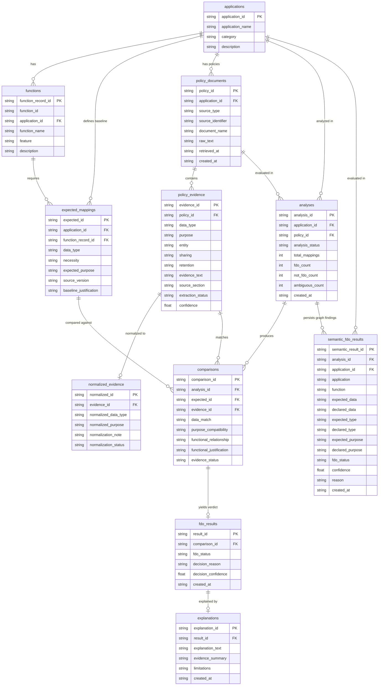
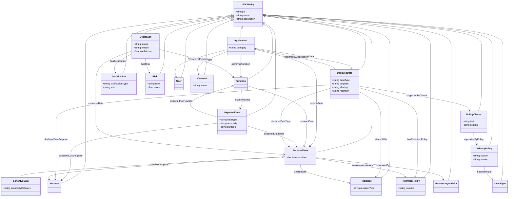

# FDO Privacy Project: Part 3 - Ontology Specification, Knowledge Graph, and Storage Architecture Audit

**Project Path:** `C:\FDO`  
**Output Document:** `docs/part3_ontology_storage.md`  
**Audit Scope:** Functional Data Ontology (FDO) Schema, RDF Graph Construction, Apache Jena Fuseki Triple Store, SPARQL & SQL Query Registry, Reasoning Reality Check, and Relational Database Architecture  
**Timestamp:** 2026-10-13  
**Auditor Status:** Automated Assistant (Strict Read-Only Audit)

---

## 1. Ontology Specification & Formal Schema Architecture

The Functional Data Ontology (FDO) provides the formal semantic schema (TBox) defining domain concepts, inter-entity object properties, literal data properties, cardinality constraints, and competency questions for detecting Functional Data Overreach (FDO).

### 1.1 Namespaces and Vocabularies

The ontology operates under a single centralized namespace defined using RDFLib (`Backend/app/ontology/namespace.py:11`). All individual instances (ABox) are assigned stable uniform resource identifiers (URIs) under a hierarchical resource base (`Backend/app/ontology/uri.py:19-45`).

| Prefix | Namespace URI | Purpose | Defining Location (`path:line`) |
| :--- | :--- | :--- | :--- |
| `fdo:` | `http://example.org/fdo#` | Core Functional Data Ontology vocabulary and classes | `Backend/app/ontology/namespace.py:11` |
| `fdo:resource/` | `http://example.org/fdo#resource/` | Base URI for concrete RDF individuals (`<type>/<id>`) | `Backend/app/ontology/uri.py:19` |
| `owl:` | `http://www.w3.org/2002/07/owl#` | W3C Web Ontology Language vocabulary | `Backend/app/ontology/owl_builder.py:23, 43` |
| `rdf:` | `http://www.w3.org/1999/02/22-rdf-syntax-ns#` | W3C Resource Description Framework syntax | `Backend/app/ontology/owl_builder.py:23, 55` |
| `rdfs:` | `http://www.w3.org/2000/01/rdf-schema#` | W3C RDF Schema vocabulary (domain, range, label, comment) | `Backend/app/ontology/owl_builder.py:23, 44` |
| `xsd:` | `http://www.w3.org/2001/XMLSchema#` | W3C XML Schema Datatypes for literal values | `Backend/app/ontology/owl_builder.py:23, 170-175` |

### 1.2 Formal Ontology Classes and Taxonomy

The ontology defines 19 formal semantic classes implemented as Python dataclasses inheriting from `FDOEntity` (`Backend/app/ontology/classes.py:1-260`) and registered in `Backend/app/ontology/registry.py:1-40`. During OWL generation, each class is serialized as an `owl:Class` (`Backend/app/ontology/owl_builder.py:86-115`).

| Class Name | Superclass | Semantic Description | Registered Fields (`dataclass`) | Defining Code (`path:line`) | Feature Status |
| :--- | :--- | :--- | :--- | :--- | :--- |
| `FDOEntity` | `object` | Root base class for all semantic individuals in the FDO domain | `id: str`, `name: str`, `description: Optional[str]` | `Backend/app/ontology/classes.py:17-23` | Implemented-verified |
| `Application` | `FDOEntity` | Represents a software application subject to privacy compliance analysis | `category: Optional[str]` | `Backend/app/ontology/classes.py:26-33` | Implemented-verified |
| `Function` | `FDOEntity` | Specific functional capability, feature, or service provided by an application | Inherits base fields | `Backend/app/ontology/classes.py:36-41` | Implemented-verified |
| `PersonalData` | `FDOEntity` | Category or type of personal information processed by the application | `sensitive: bool = False` | `Backend/app/ontology/classes.py:44-51` | Implemented-verified |
| `SensitiveData` | `PersonalData` | Specialization of personal data carrying heightened privacy risk (e.g., biometrics, location, health) | `sensitivity_category: Optional[str]`, `sensitive = True` | `Backend/app/ontology/classes.py:54-68` | Implemented-verified |
| `ProcessingActivity` | `FDOEntity` | Operation performed on data (collection, sharing, storage, analysis, derivation) | Inherits base fields | `Backend/app/ontology/classes.py:71-76` | Implemented-verified |
| `Purpose` | `FDOEntity` | Justified business or functional objective for processing data | Inherits base fields | `Backend/app/ontology/classes.py:79-84` | Implemented-verified |
| `Recipient` | `FDOEntity` | Internal or third-party entity receiving personal data | `recipient_type: Optional[str]` | `Backend/app/ontology/classes.py:87-94` | Implemented-verified |
| `RetentionPolicy` | `FDOEntity` | Rule governing retention duration and disposition criteria | `duration: Optional[str]` | `Backend/app/ontology/classes.py:97-104` | Implemented-verified |
| `User` | `FDOEntity` | End-user or data subject interacting with the application | Inherits base fields | `Backend/app/ontology/classes.py:107-112` | Implemented-verified |
| `UserRight` | `FDOEntity` | Legal or policy right available to the data subject (opt-out, deletion, access) | Inherits base fields | `Backend/app/ontology/classes.py:115-120` | Implemented-verified |
| `Consent` | `FDOEntity` | Consent mechanism or state granted for specific data processing | `status: Optional[str]` | `Backend/app/ontology/classes.py:123-130` | Implemented-verified |
| `PrivacyPolicy` | `FDOEntity` | Source privacy disclosure document governing the application | `source: Optional[str]`, `version: Optional[str]` | `Backend/app/ontology/classes.py:133-141` | Implemented-verified |
| `PolicyClause` | `FDOEntity` | Granular excerpt or textual disclosure from a privacy policy document | `text: str`, `source: Optional[str]`, `section: Optional[str]` | `Backend/app/ontology/classes.py:144-153` | Implemented-verified |
| `ExpectedData` | `FDOEntity` | Baseline data item reasonably expected for a specific software feature | `data_type: Optional[str]`, `necessity: Optional[str]`, `purpose: Optional[str]` | `Backend/app/ontology/classes.py:156-166` | Implemented-verified |
| `DeclaredData` | `FDOEntity` | Data practice claimed/declared in the application's privacy policy disclosures | `data_type: Optional[str]`, `purpose: Optional[str]`, `sharing: Optional[str]`, `retention: Optional[str]` | `Backend/app/ontology/classes.py:169-180` | Implemented-verified |
| `Justification` | `FDOEntity` | Rationalization explaining why a functional expectation is established or breached | `justification_type: Optional[str]`, `text: Optional[str]` | `Backend/app/ontology/classes.py:183-191` | Implemented-verified |
| `Overreach` | `FDOEntity` | Explicit finding indicating a discrepancy between functional need and declared data collection | `status: str = "potential"`, `reason: Optional[str]`, `confidence: Optional[float]` | `Backend/app/ontology/classes.py:194-203` | Implemented-verified |
| `Risk` | `FDOEntity` | Quantified or qualitative privacy risk impact associated with an overreach finding | `level: Optional[str]`, `score: Optional[float]` | `Backend/app/ontology/classes.py:206-214` | Implemented-verified |

### 1.3 Object Properties (Relationships)

Relationships connect ontology entities to form semantic knowledge graphs. All 24 object properties are registered in `Backend/app/ontology/properties.py:51-217` and serialized as `owl:ObjectProperty` with `rdfs:domain` and `rdfs:range` in `Backend/app/ontology/owl_builder.py:120-165`.

| Object Property Name | Domain Class (`rdfs:domain`) | Range Class (`rdfs:range`) | Semantic Relationship Description | Defining Code (`path:line`) | Feature Status |
| :--- | :--- | :--- | :--- | :--- | :--- |
| `performsFunction` | `Application` | `Function` | Connects an application to a function it performs | `Backend/app/ontology/properties.py:52-57` | Implemented-verified |
| `requiresData` | `Function` | `PersonalData` | Connects a function to data reasonably required for that function | `Backend/app/ontology/properties.py:59-64` | Implemented-verified |
| `collectsData` | `Application` | `PersonalData` | Connects an application to personal data it collects | `Backend/app/ontology/properties.py:66-71` | Implemented-verified |
| `declaredData` | `Application` | `DeclaredData` | Connects an application to data declared in its privacy policy | `Backend/app/ontology/properties.py:73-78` | Implemented-verified |
| `expectedData` | `Function` | `ExpectedData` | Connects a function to expected baseline data requirements | `Backend/app/ontology/properties.py:80-85` | Implemented-verified |
| `expectedForFunction` | `ExpectedData` | `Function` | Inverse relationship linking expected data back to its parent function | `Backend/app/ontology/properties.py:87-92` | Implemented-verified |
| `declaredByApplication` | `DeclaredData` | `Application` | Inverse relationship connecting declared data back to the declaring app | `Backend/app/ontology/properties.py:94-99` | Implemented-verified |
| `usedForPurpose` | `PersonalData` | `Purpose` | Connects personal data to its stated processing purpose | `Backend/app/ontology/properties.py:101-106` | Implemented-verified |
| `processedBy` | `PersonalData` | `ProcessingActivity` | Connects personal data to processing activities applied to it | `Backend/app/ontology/properties.py:108-113` | Implemented-verified |
| `sharedWith` | `PersonalData` | `Recipient` | Connects personal data to external recipients receiving it | `Backend/app/ontology/properties.py:115-120` | Implemented-verified |
| `hasRetentionPolicy` | `PersonalData` | `RetentionPolicy` | Connects personal data to its governing retention policy | `Backend/app/ontology/properties.py:122-127` | Implemented-verified |
| `supportedByClause` | `DeclaredData` | `PolicyClause` | Connects a declared data practice to policy clause evidence | `Backend/app/ontology/properties.py:129-134` | Implemented-verified |
| `supportedByPolicy` | `PolicyClause` | `PrivacyPolicy` | Connects an extracted policy clause to its source document | `Backend/app/ontology/properties.py:136-141` | Implemented-verified |
| `hasUserRight` | `PrivacyPolicy` | `UserRight` | Connects a privacy policy to data subject rights it guarantees | `Backend/app/ontology/properties.py:143-148` | Implemented-verified |
| `hasConsent` | `Application` | `Consent` | Connects an application to a consent record | `Backend/app/ontology/properties.py:150-155` | Implemented-verified |
| `hasJustification` | `Overreach` | `Justification` | Connects an overreach finding to its legal or technical justification | `Backend/app/ontology/properties.py:157-162` | Implemented-verified |
| `concernsData` | `Overreach` | `PersonalData` | Connects an overreach finding to the disproportionate data involved | `Backend/app/ontology/properties.py:164-169` | Implemented-verified |
| `concernsFunction` | `Overreach` | `Function` | Connects an overreach finding to the affected application function | `Backend/app/ontology/properties.py:171-176` | Implemented-verified |
| `hasRisk` | `Overreach` | `Risk` | Connects an overreach finding to an evaluated privacy risk level | `Backend/app/ontology/properties.py:178-183` | Implemented-verified |
| `hasUser` | `Application` | `User` | Connects an application to its user context | `Backend/app/ontology/properties.py:185-190` | Implemented-verified |
| `expectedDataType` | `ExpectedData` | `PersonalData` | Connects expected data to the semantic personal data concept | `Backend/app/ontology/properties.py:191-196` | Implemented-verified |
| `declaredDataType` | `DeclaredData` | `PersonalData` | Connects declared data to the semantic personal data concept | `Backend/app/ontology/properties.py:198-203` | Implemented-verified |
| `expectedDataPurpose` | `ExpectedData` | `Purpose` | Connects expected data to its semantic processing purpose | `Backend/app/ontology/properties.py:204-209` | Implemented-verified |
| `declaredDataPurpose` | `DeclaredData` | `Purpose` | Connects declared data to its semantic processing purpose | `Backend/app/ontology/properties.py:211-216` | Implemented-verified |

### 1.4 Data Properties (Literal Attributes)

Data properties bind ontology entities to primitive literal values. All 23 data properties are declared in `Backend/app/ontology/data_properties.py:52-214` and serialized as `owl:DatatypeProperty` with `rdfs:range` mapped to W3C XML Schema datatypes (`Backend/app/ontology/owl_builder.py:170-227`).

| Data Property Name | Domain Class (`rdfs:domain`) | Datatype String | XML Schema Datatype (`rdfs:range`) | Description | Defining Code (`path:line`) |
| :--- | :--- | :--- | :--- | :--- | :--- |
| `id` | `FDOEntity` | `"string"` | `xsd:string` | Unique identifier of an ontology entity | `Backend/app/ontology/data_properties.py:54-59` |
| `name` | `Application` | `"string"` | `xsd:string` | Human-readable name of an ontology entity | `Backend/app/ontology/data_properties.py:61-66` |
| `description` | `FDOEntity` | `"string"` | `xsd:string` | Human-readable description of an ontology entity | `Backend/app/ontology/data_properties.py:68-73` |
| `category` | `Application` | `"string"` | `xsd:string` | Application market category (e.g., Navigation, Social) | `Backend/app/ontology/data_properties.py:75-80` |
| `sensitive` | `PersonalData` | `"boolean"` | `xsd:boolean` | Boolean flag indicating sensitive personal data | `Backend/app/ontology/data_properties.py:82-87` |
| `sensitivityCategory`| `PersonalData` | `"string"` | `xsd:string` | Classification category (e.g., precise_location, biometrics) | `Backend/app/ontology/data_properties.py:89-94` |
| `duration` | `RetentionPolicy` | `"string"` | `xsd:string` | Retention period string (e.g., "30 days", "session") | `Backend/app/ontology/data_properties.py:96-101` |
| `recipientType` | `Recipient` | `"string"` | `xsd:string` | Classification of third party (e.g., advertiser, vendor) | `Backend/app/ontology/data_properties.py:103-108` |
| `status` | `Consent` | `"string"` | `xsd:string` | Consent state or status | `Backend/app/ontology/data_properties.py:110-115` |
| `source` | `PrivacyPolicy` | `"string"` | `xsd:string` | Policy source location, URL, or document origin | `Backend/app/ontology/data_properties.py:117-122` |
| `version` | `PrivacyPolicy` | `"string"` | `xsd:string` | Version identifier or publication date of policy | `Backend/app/ontology/data_properties.py:124-129` |
| `text` | `PolicyClause` | `"string"` | `xsd:string` | Verbatim text excerpt supporting extraction | `Backend/app/ontology/data_properties.py:131-136` |
| `section` | `PolicyClause` | `"string"` | `xsd:string` | Policy section heading containing the clause | `Backend/app/ontology/data_properties.py:138-143` |
| `dataType` | `ExpectedData` | `"string"` | `xsd:string` | Controlled data type identifier (e.g., DATA.LOCATION.PRECISE)| `Backend/app/ontology/data_properties.py:145-150` |
| `necessity` | `ExpectedData` | `"string"` | `xsd:string` | Necessity tier (`L1_REQUIRED`, `L2_SUPPORTIVE`, `L3_ANCILLARY`)| `Backend/app/ontology/data_properties.py:152-157` |
| `purpose` | `ExpectedData` | `"string"` | `xsd:string` | Baseline functional purpose justification | `Backend/app/ontology/data_properties.py:159-164` |
| `sharing` | `DeclaredData` | `"string"` | `xsd:string` | Sharing disclosure string extracted from policy | `Backend/app/ontology/data_properties.py:166-171` |
| `retention` | `DeclaredData` | `"string"` | `xsd:string` | Retention disclosure string extracted from policy | `Backend/app/ontology/data_properties.py:173-178` |
| `justificationType` | `Justification` | `"string"` | `xsd:string` | Category of justification supporting baseline requirement | `Backend/app/ontology/data_properties.py:180-185` |
| `reason` | `Overreach` | `"string"` | `xsd:string` | Textual explanation rationalizing overreach verdict | `Backend/app/ontology/data_properties.py:187-192` |
| `confidence` | `Overreach` | `"float"` | `xsd:float` | Numerical confidence score (0.0 - 1.0) of finding | `Backend/app/ontology/data_properties.py:194-199` |
| `level` | `Risk` | `"string"` | `xsd:string` | Qualitative risk tier (`LOW`, `MEDIUM`, `HIGH`) | `Backend/app/ontology/data_properties.py:201-206` |
| `score` | `Risk` | `"float"` | `xsd:float` | Numerical risk metric score | `Backend/app/ontology/data_properties.py:208-213` |

### 1.5 Structural Constraints (Cardinality & Mandatory Properties)

Structural rules governing the FDO knowledge graph are codified in `Backend/app/ontology/constraints.py:1-206`. They define cardinality bounds and required fields ready for translation into OWL restrictions or SHACL validation shapes.

#### Cardinality Constraints (`Backend/app/ontology/constraints.py:50-154`)

| Target Property | Domain Class | Min Count | Max Count | Semantic Integrity Requirement |
| :--- | :--- | :--- | :--- | :--- |
| `performsFunction` | `Application` | 1 | Unbounded | Every application must perform at least one function. |
| `requiresData` | `Function` | 0 | Unbounded | A function may require zero or more personal data types. |
| `collectsData` | `Application` | 0 | Unbounded | An application may collect zero or more personal data types. |
| `declaredData` | `Application` | 0 | Unbounded | An application may declare zero or more data practices. |
| `expectedData` | `Function` | 0 | Unbounded | A function may possess zero or more baseline expected data mappings. |
| `usedForPurpose` | `PersonalData` | 0 | Unbounded | Personal data may be associated with zero or more processing purposes. |
| `processedBy` | `PersonalData` | 0 | Unbounded | Personal data may undergo zero or more processing activities. |
| `sharedWith` | `PersonalData` | 0 | Unbounded | Personal data may be transmitted to zero or more recipients. |
| `hasRetentionPolicy`| `PersonalData` | 0 | 1 | Personal data may have at most one primary retention policy. |
| `supportedByClause` | `DeclaredData` | 0 | Unbounded | Declared data may be backed by zero or more policy clause citations. |
| `hasJustification` | `Overreach` | 0 | 1 | An overreach finding may have at most one primary justification record. |
| `concernsData` | `Overreach` | 1 | 1 | An overreach finding must concern exactly one primary personal data item. |
| `concernsFunction` | `Overreach` | 0 | 1 | An overreach finding may concern one primary application function. |
| `hasRisk` | `Overreach` | 0 | 1 | An overreach finding may be linked to at most one primary risk assessment. |

#### Required Property Constraints (`Backend/app/ontology/constraints.py:157-206`)

| Required Property | Domain Class | Constraint Description |
| :--- | :--- | :--- |
| `name` | `Application` | Every application entity must declare a non-empty human-readable name. |
| `name` | `Function` | Every function entity must declare a non-empty human-readable name. |
| `name` | `PersonalData` | Every personal data entity must declare a canonical name. |
| `dataType` | `ExpectedData` | Every expected baseline requirement must identify its data type token. |
| `dataType` | `DeclaredData` | Every extracted policy declaration must identify its data type token. |
| `text` | `PolicyClause` | Every policy clause entity must contain the verbatim extracted policy quote. |
| `source` | `PrivacyPolicy` | Every privacy policy document must reference its origin URL or document title. |
| `reason` | `Overreach` | Every overreach finding must provide an explainable decision rationale. |

### 1.6 Competency Questions (Specification Benchmark)

The ontology is benchmarked against 20 formal Competency Questions (CQ01–CQ20) defined in `Backend/app/ontology/competency_questions.py:26-167`. These define the exact reasoning and query capabilities required of the FDO knowledge graph:

| ID | Competency Question | Analytical Purpose | Target Semantic Entities |
| :--- | :--- | :--- | :--- |
| **CQ01** | What functions does an application perform? | Enumerate functional capabilities | `Application`, `Function` |
| **CQ02** | What personal data does a function reasonably require? | Establish functional baseline | `Function`, `PersonalData` |
| **CQ03** | What personal data does an application collect? | Identify observed collection practices | `Application`, `PersonalData` |
| **CQ04** | Which collected data is expected for a given function? | Align collection with functionality | `ExpectedData`, `DeclaredData` |
| **CQ05** | Which collected data has no corresponding functional requirement? | Detect Functional Data Overreach (FDO) | Disconnected `DeclaredData` nodes |
| **CQ06** | For what purposes is personal data used? | Establish semantic purpose scope | `PersonalData`, `Purpose` |
| **CQ07** | Is the declared purpose compatible with the expected functional purpose? | Evaluate purpose compatibility | `ExpectedData`, `DeclaredData`, `Purpose` |
| **CQ08** | Which personal data is shared with external recipients? | Audit third-party sharing | `PersonalData`, `Recipient` |
| **CQ09** | How long is personal data retained? | Audit data retention duration | `PersonalData`, `RetentionPolicy` |
| **CQ10** | Which policy clause provides evidence for a declared data practice? | Maintain evidentiary traceability | `DeclaredData`, `PolicyClause` |
| **CQ11** | Which privacy policy contains a particular policy clause? | Document provenance | `PolicyClause`, `PrivacyPolicy` |
| **CQ12** | Which data collection practices are associated with an FDO finding? | Trace affected data in overreach | `Overreach`, `PersonalData` |
| **CQ13** | Which function is affected by a potential FDO finding? | Trace affected feature in overreach | `Overreach`, `Function` |
| **CQ14** | Why was a data practice classified as Functional Data Overreach? | Generate explainable decision rationale | `Overreach`, `Justification` |
| **CQ15** | What privacy risk is associated with an FDO finding? | Quantify privacy harm | `Overreach`, `Risk` |
| **CQ16** | Which applications collect sensitive personal data? | Detect sensitive data exposure | `Application`, `SensitiveData` |
| **CQ17** | Which applications collect data for purposes unrelated to their primary function? | Detect secondary purpose overreach | `Application`, `Function`, `Purpose` |
| **CQ18** | Which data practices have insufficient policy evidence? | Flag ambiguous or unverified disclosures | Unsubstantiated `DeclaredData` |
| **CQ19** | Which applications have potential Functional Data Overreach? | Compute application-level compliance | `Application`, `Overreach` |
| **CQ20** | What evidence supports an FDO decision for a specific application? | Produce end-to-end audit trails | Full graph traversal |

### 1.7 Static Ontology Artifacts and Builders

The FDO OWL schema is materialized on disk as an RDF/XML file generated by code:

- **Generation Script:** `Backend/scripts/generate_fdo_ontology.py:1-38` calls `Backend/app/ontology/owl_builder.py::serialize_fdo_ontology` (`Backend/app/ontology/owl_builder.py:231-253`).
- **Disk Artifact:** `Backend/ontology/FDO.owl` (436 lines, 26,258 bytes, RDF/XML format).
- **Inspection Script:** `Backend/scripts/verify_fdo_owl.py:1-23` parses `FDO.owl` using RDFLib and reports:
  - Total Triples: **312**
  - Classes: **19** (`owl:Class`)
  - Object Properties: **24** (`owl:ObjectProperty`)
  - Datatype Properties: **23** (`owl:DatatypeProperty`)

---

## 2. Extracted Data Conversion to RDF Triples / Knowledge Graph Nodes

The FDO system dynamically converts relational database records into an RDF knowledge graph representing the application, its declared evidence, and its baseline functional expectations.

### 2.1 Static Test Graphs vs. Dynamic Runtime Pipeline

The codebase contains two distinct graph generation mechanisms:

1. **Static Test Fixtures:**
   - Script: `Backend/scripts/export_fdo_test_graph.py:21-86` constructs a test graph of 17 explicit triples and exports it to `Backend/ontology/fdo-test-data.ttl` (29 lines, 1,181 bytes).
   - Fixture: `Backend/ontology/fdo-semantic-fixture.ttl` (35 lines, 996 bytes) provides a static baseline for offline unit testing.
2. **Dynamic Runtime Knowledge Graph Builder:**
   - During full analysis runs (`POST /analyses/{application_id}/run` in `Backend/app/main.py:388-420`), relational records stored in SQLite are mapped in memory to an `rdflib.Graph`, serialized to Turtle format on disk, and uploaded to the triple store.

### 2.2 Dynamic Transformation Pipeline Trace

```
SQLite Relational DB (SQLAlchemy Models)
   │  (applications, functions, expected_mappings, policy_evidence)
   ▼
[ 1. Repository Fetch ]  -->  Backend/app/ontology/db_semantic_repository.py:20-75
   │  get_application(), get_functions(), get_expected_mappings(), get_policy_evidence()
   ▼
[ 2. Record Adapters ]   -->  Backend/app/ontology/db_rdf_mapper.py:23-78
   │  application_from_record(), function_from_record(),
   │  expected_data_from_record(), declared_data_from_record()
   ▼
[ 3. Domain Dataclasses ] ->  FDOEntity instances (Application, Function, ExpectedData, DeclaredData)
   │
   ▼
[ 4. Graph Construction ] ->  Backend/app/ontology/db_rdf_service.py:29-117
   │  Calls rdf_instance_builder.py (1,048 lines)
   │  add_application(), add_function(), add_expected_data(), add_declared_data()
   │  connect_application_function(), connect_function_expected_data(), connect_application_declared_data()
   ▼
[ 5. RDF Graph (in-memory) ] -> rdflib.Graph bound to namespace http://example.org/fdo#
   │
   ▼
[ 6. Serialization & Publish ] -> Backend/app/ontology/semantic_fuseki_service.py:24-50
   │  Serializes graph as Turtle (.ttl) to outputs/semantic/ANALYSIS-{analysis_id}.ttl
   ▼
[ 7. Triple Store Upload ]   --> HTTP POST to Apache Jena Fuseki Graph Store Protocol (/data)
```

### 2.3 Detailed Adapter and Mapping Implementations

| Pipeline Stage | Function Name | Input Data Type | Output / RDF Node Produced | Code Location (`path:line`) |
| :--- | :--- | :--- | :--- | :--- |
| **Application Mapping** | `application_from_record` | SQLAlchemy `Application` ORM or `dict` | Dataclass `Application(id, name, category, description)` | `Backend/app/ontology/db_rdf_mapper.py:23-33` |
| **Application RDF Generation** | `add_application` | Dataclass `Application` | RDF Individual `<fdo#resource/application/{id}>` with `fdo:id`, `fdo:name`, `fdo:category` | `Backend/app/ontology/rdf_instance_builder.py:104-125` |
| **Function Mapping** | `function_from_record` | SQLAlchemy `Function` ORM or `dict` | Dataclass `Function(id=function_record_id, name, description)` | `Backend/app/ontology/db_rdf_mapper.py:36-49` |
| **Function RDF Generation** | `add_function` | Dataclass `Function` | RDF Individual `<fdo#resource/function/{id}>` with `fdo:id`, `fdo:name`, `fdo:description` | `Backend/app/ontology/rdf_instance_builder.py:127-147` |
| **Expected Data Mapping** | `expected_data_from_record`| SQLAlchemy `ExpectedMapping` ORM or `dict` | Dataclass `ExpectedData(id, name, data_type, necessity, purpose)` | `Backend/app/ontology/db_rdf_mapper.py:52-63` |
| **Expected Data RDF Generation**| `add_expected_data` | Dataclass `ExpectedData` | RDF Individual `<fdo#resource/expected-data/{id}>` with `fdo:dataType`, `fdo:necessity`, `fdo:purpose` | `Backend/app/ontology/rdf_instance_builder.py:204-226` |
| **Declared Data Mapping** | `declared_data_from_record`| SQLAlchemy `PolicyEvidence` ORM or `dict` | Dataclass `DeclaredData(id, name, data_type, purpose, sharing, retention)` | `Backend/app/ontology/db_rdf_mapper.py:66-78` |
| **Declared Data RDF Generation**| `add_declared_data` | Dataclass `DeclaredData` | RDF Individual `<fdo#resource/declared-data/{id}>` with `fdo:dataType`, `fdo:purpose`, `fdo:sharing`, `fdo:retention` | `Backend/app/ontology/rdf_instance_builder.py:228-250` |
| **App-Function Connection** | `connect_application_function` | App ID, Function ID | RDF Triple `(?app, fdo:performsFunction, ?function)` | `Backend/app/ontology/rdf_instance_builder.py:488-502` |
| **Func-Expected Connection**| `connect_function_expected_data` | Function ID, Expected ID | Bidirectional Triples `(?func, fdo:expectedData, ?exp)`, `(?exp, fdo:expectedForFunction, ?func)` | `Backend/app/ontology/rdf_instance_builder.py:504-528` |
| **App-Declared Connection** | `connect_application_declared_data`| App ID, Declared ID | Bidirectional Triples `(?app, fdo:declaredData, ?dec)`, `(?dec, fdo:declaredByApplication, ?app)` | `Backend/app/ontology/rdf_instance_builder.py:530-554` |

---

## 3. Knowledge Graph Storage Technology, Node Labels, Relationship Types, and Disk Artifacts

### 3.1 Triple Store Technology Stack

| Component | Technology | Configuration / Version | Operational Role | Code Citation (`path:line`) |
| :--- | :--- | :--- | :--- | :--- |
| **In-Memory RDF Processor** | `rdflib>=7.1.3` | Pure Python RDF graph model (`rdflib.Graph`) | Constructs, manipulates, and serializes ABox graphs during request execution | `Backend/app/ontology/db_rdf_service.py:3, 37` |
| **External Triple Store Engine** | Apache Jena Fuseki | Jena Fuseki 4.x / 5.x running on `http://localhost:3030` | Persistent SPARQL endpoint for query pattern matching and inference testing | `Backend/app/ontology/fuseki_service.py:7-13` |
| **Target Dataset (Runtime)** | Fuseki dataset `/fdo` or `/fdo-reasoning` | In-memory or TDB dataset configured in Fuseki | Stores the active application knowledge graph per analysis run | `Backend/app/ontology/semantic_fuseki_service.py:21` |
| **HTTP Client Protocol** | Python `requests` | REST API (SPARQL 1.1 Query, Update, and Graph Store Protocols) | Issues POST requests for query, clear, and TTL upload | `Backend/app/ontology/fuseki_service.py:27-70` |
| **Graceful Degradation / Fallback** | Try-Except Exception Block | Catches `Exception` around Fuseki calls; continues pipeline | If Fuseki is offline or unreachable, analysis succeeds via deterministic SQLite rules; semantic results default to empty | `Backend/app/main.py:418-420` |

### 3.2 Individual Node URIs and Naming Conventions

Concrete RDF individuals follow a strict URI naming pattern created by `Backend/app/ontology/uri.py::build_resource_uri`:  
Pattern: `http://example.org/fdo#resource/<entity_type>/<id>`

| Entity Type | RDF Individual URI Example | Source Database Column / Identifier |
| :--- | :--- | :--- |
| **Application** | `http://example.org/fdo#resource/application/NAV-01` | `applications.application_id` |
| **Function** | `http://example.org/fdo#resource/function/NAV-01:FUNC.NAV.TURNBYTURN` | `functions.function_record_id` |
| **Expected Data** | `http://example.org/fdo#resource/expected-data/EXP-015` | `expected_mappings.expected_id` |
| **Declared Data** | `http://example.org/fdo#resource/declared-data/AI-a7ad0d61` | `policy_evidence.evidence_id` |
| **Privacy Policy** | `http://example.org/fdo#resource/policy/POL-NAV-01` | `policy_documents.policy_id` |
| **Policy Clause** | `http://example.org/fdo#resource/policy-clause/CLAUSE-001` | String clause identifier |
| **Personal Data** | `http://example.org/fdo#resource/personal-data/precise_location` | Normalized data type string (lowercased) |
| **Purpose** | `http://example.org/fdo#resource/purpose/advertising` | Normalized purpose category (lowercased) |
| **Recipient** | `http://example.org/fdo#resource/recipient/third_party_advertiser` | Recipient identifier (lowercased) |
| **Retention Policy**| `http://example.org/fdo#resource/retention-policy/30_days` | Retention duration identifier (lowercased) |
| **Overreach** | `http://example.org/fdo#resource/overreach/OVERREACH-001` | Overreach finding identifier |
| **Justification** | `http://example.org/fdo#resource/justification/JUST-001` | Justification record identifier |
| **Risk** | `http://example.org/fdo#resource/risk/RISK-001` | Risk record identifier |
| **Processing Activity**| `http://example.org/fdo#resource/processing-activity/collection` | Activity string (lowercased) |

### 3.3 Disk Artifacts on the Filesystem

Inspection of `C:\FDO` identified the following concrete graph artifacts:

| File Path | Format | Size (Bytes) | Line Count | Role / Content |
| :--- | :--- | :--- | :--- | :--- |
| `Backend/ontology/FDO.owl` | RDF/XML | 26,258 | 436 | Formal FDO TBox schema containing 19 classes, 24 object properties, 23 datatype properties |
| `Backend/ontology/fdo-test-data.ttl` | Turtle | 1,181 | 29 | Static unit test graph (Navigation App, function, expected location, declared location) |
| `Backend/ontology/fdo-semantic-fixture.ttl`| Turtle | 996 | 35 | Static test fixture with explicit relationships |
| `Backend/outputs/semantic/ANALYSIS-NAV-01-*.ttl` (23 files) | Turtle | 2,748 each | 60 each | Dynamically generated ABox knowledge graphs produced during actual pipeline analysis executions for Google Maps (`NAV-01`) |

---

## 4. SPARQL and SQL Queries

The FDO platform executes SPARQL queries against RDF graphs (via Fuseki or RDFLib) and SQL queries via SQLAlchemy ORM against SQLite.

### 4.1 SPARQL Query Registry

| Query Identifier | Source File (`path:line`) | Target Graph / Endpoint | Analytical Purpose & Filter Pattern | Consuming Code (`path::function`) |
| :--- | :--- | :--- | :--- | :--- |
| `FDO_DETECTION_QUERY` | `Backend/app/ontology/fdo_detection_queries.py:5-37` | Apache Jena Fuseki (`/query`) | Traverses `?application -> ?function -> ?expectedData` and `?application -> ?declaredData`. Filters where `STR(?expectedType) != STR(?declaredType) \|\| STR(?expectedPurpose) != STR(?declaredPurpose)` | `fuseki_semantic_detector.py::detect_fdo` |
| `STANDALONE_FDO_DETECTION_QUERY` | `Backend/app/ontology/fdo_semantic_detector.py:6-31` | In-memory `rdflib.Graph` | Fallback comparison matching `?expectedData` vs `?declaredData` directly when functional links are absent | `fdo_semantic_detector.py::detect_fdo` |
| `SENSITIVE_DATA_QUERY` | `Backend/app/ontology/fdo_detection_queries.py:39-55` | Apache Jena Fuseki (`/query`) | Selects all `?data a fdo:SensitiveData` where `fdo:sensitive true`, extracting optional `fdo:sensitivityCategory` | `fdo_detection_queries.py` (Registered query) |
| `QUERY_ALL_OVERREACH` | `Backend/app/ontology/sparql_queries.py:10-21` | In-memory `rdflib.Graph` | Enumerate all `?overreach a fdo:Overreach` with optional linked `?data` and `?function` | `sparql_service.py::query_to_dicts` |
| `QUERY_OVERREACH_DETAILS` | `Backend/app/ontology/sparql_queries.py:23-44` | In-memory `rdflib.Graph` | Detailed overreach retrieval joining `?overreach` to `?justification` and `?risk` | `sparql_service.py::query_to_dicts` |
| `QUERY_SENSITIVE_DATA` | `Backend/app/ontology/sparql_queries.py:46-54` | In-memory `rdflib.Graph` | Queries sensitive data individuals and category strings | `sparql_service.py::query_to_dicts` |
| `QUERY_DATA_BY_PURPOSE` | `Backend/app/ontology/sparql_queries.py:56-62` | In-memory `rdflib.Graph` | Joins `fdo:PersonalData` to `fdo:usedForPurpose` | `sparql_service.py::query_to_dicts` |
| `inspect-fdo.rq` | `Backend/ontology/inspect-fdo.rq:1-10` | Offline / CLI tool | Selects IDs for expected-001 and declared-001 individuals via `VALUES` clause | Manual / Fuseki UI inspection |
| `reasoning-count.rq` | `Backend/ontology/reasoning-count.rq:1-4` | Offline / CLI tool | Triple count query: `SELECT (COUNT(*) AS ?count) WHERE { ?s ?p ?o }` | Fuseki reasoning testing |
| `reasoning-test.rq` | `Backend/ontology/reasoning-test.rq:1-11` | Offline / CLI tool | Inspects inferred `rdf:type` triples for `expected-001` individual | `Backend/test_fdo_jena_reasoning.py` |

#### Core SPARQL Detection Query (`FDO_DETECTION_QUERY`)

```sparql
PREFIX fdo: <http://example.org/fdo#>

SELECT
    ?application
    ?function
    ?expectedData
    ?declaredData
    ?expectedType
    ?declaredType
    ?expectedPurpose
    ?declaredPurpose
WHERE {
    ?application a fdo:Application ;
                 fdo:performsFunction ?function ;
                 fdo:declaredData ?declaredData .

    ?function a fdo:Function ;
              fdo:expectedData ?expectedData .

    ?expectedData fdo:dataType ?expectedType ;
                  fdo:purpose ?expectedPurpose .

    ?declaredData fdo:dataType ?declaredType ;
                  fdo:purpose ?declaredPurpose .

    FILTER (
        STR(?expectedType) != STR(?declaredType)
        ||
        STR(?expectedPurpose) != STR(?declaredPurpose)
    )
}
```

### 4.2 SQL / SQLAlchemy ORM Query Registry

Relational queries are managed through SQLAlchemy 2.0 select statements across backend service modules:

| Target Table | Query Type / ORM Statement | Filters & Conditions | Purpose | Defining Location (`path:line`) |
| :--- | :--- | :--- | :--- | :--- |
| `applications` | `select(Application).order_by(...)` | None | List all registered applications | `Backend/app/services/application_service.py:11-16` |
| `applications` | `select(Application).where(...)` | `func.lower(func.trim(name)) == normalized` | Application lookup by name | `Backend/app/services/application_service.py:43-48` |
| `applications` | `session.get(Application, id)` | Primary Key | Fetch single application entity | `Backend/app/services/application_service.py:19-23` |
| `functions` | `select(Function).where(...)` | `Function.application_id == id` | Retrieve all functions for an application | `Backend/app/services/function_service.py:16-27` |
| `expected_mappings`| `select(ExpectedMapping).where(...)`| `ExpectedMapping.application_id == id` | Retrieve baseline expectations for an application | `Backend/app/services/expected_mapping_service.py:18-31` |
| `expected_mappings`| `select(ExpectedMapping).where(...)`| `ExpectedMapping.function_record_id == id` | Retrieve baseline expectations for a function | `Backend/app/services/expected_mapping_service.py:33-47` |
| `policy_documents` | `select(PolicyDocument).where(...)` | `PolicyDocument.application_id == id` | Retrieve policy documents for an application | `Backend/app/services/policy_service.py:17-29` |
| `policy_evidence` | `select(PolicyEvidence).where(...)` | `PolicyEvidence.policy_id == id` | Retrieve extracted evidence for a policy | `Backend/app/services/evidence_service.py:17-29` |
| `policy_evidence` | `select(PolicyEvidence).where(...)` | `PolicyEvidence.policy_id.in_(ids)` | Count extracted evidence items for application readiness | `Backend/app/services/application_service.py:145-155` |
| `analyses` | `select(Analysis, Application).join(...)`| `Analysis.application_id == Application.application_id` | List all historical compliance analysis runs | `Backend/app/services/analysis_service.py:55-83` |
| `comparisons` | `select(Comparison).where(...)` | `Comparison.analysis_id == id` | Fetch pairwise mapping comparisons for an analysis run | `Backend/app/services/analysis_service.py:85-100` |
| `fdo_results` | `select(FDOResult).join(Comparison)...`| `Comparison.analysis_id == id` | Fetch final FDO compliance verdicts for an analysis run | `Backend/app/services/analysis_service.py:103-123` |
| `semantic_fdo_results`| `session.query(SemanticFDOResult).filter(...)`| `SemanticFDOResult.analysis_id == id` | Retrieve persisted semantic graph findings | `Backend/app/ontology/semantic_result_repository.py:51-63` |

---

## 5. Reasoning Evaluation: Reality Check vs. Potential Claims

To ensure patent claims and IDF-B technical documentation reflect the true codebase implementation without exaggeration, the computational mechanics of the semantic layer are explicitly categorized:

### 5.1 Reality Check Breakdown

| Computational Subsystem | Actual Mechanism Used in Codebase | NOT Used / Mythical Claim | Code Evidence | Feature Status |
| :--- | :--- | :--- | :--- | :--- |
| **Ontology Parsing** | Pure RDFLib graph parser (`Graph().parse(path, format="xml")`) reading static XML/TTL files | No specialized ontology reasoner daemon during ingestion | `Backend/scripts/verify_fdo_owl.py:5-7`, `Backend/ontology/owl_builder.py:246-251` | Implemented-verified |
| **Graph Querying** | W3C SPARQL 1.1 graph pattern matching executed by RDFLib or Apache Jena Fuseki via HTTP POST | No semantic graph traversal algorithms (e.g., Graph Neural Networks, Dijkstra) | `Backend/app/ontology/fuseki_service.py:27-37`, `fdo_detection_queries.py:5-37` | Implemented-verified |
| **Overreach Classification** | Deterministic 6-rule Python decision tree (`evaluate_fdo_decision`) evaluating Boolean combinations of `data_match` and `purpose_compatibility` | **NOT OWL DL reasoning.** Not Tableau theorem proving, not HermiT, not Pellet, not FaCT++ | `Backend/app/services/fdo_decision_service.py:27-147`, `semantic_decision_adapter.py:71-82` | Implemented-verified |
| **Semantic Detection Bridge** | SPARQL query extracts mismatch tuples; adapter (`semantic_finding_to_decision_input`) formats tuples into Python decision objects | SPARQL query does NOT write verdicts; Python decision engine assigns `FDO`, `NOT_FDO`, or `AMBIGUOUS` | `Backend/app/ontology/semantic_decision_adapter.py:15-68` | Implemented-verified |
| **True OWL / RDFS Inference** | Apache Jena inference dataset `/fdo-reasoning` tested in `test_fdo_jena_reasoning.py` for inferring `fdo:ExpectedData rdfs:subClassOf fdo:FDOEntity` and expanding triple counts (>312) | **NOT invoked during standard Python API run.** Runtime `main.py` catches Fuseki failures gracefully; default pipeline relies on SQLite | `Backend/test_fdo_jena_reasoning.py:133-169`, `main.py:418-420` | Prototype / Verified in Tests |

### 5.2 The Exact Semantic Decision Bridge Flow

The integration between the semantic graph query and final verdict adjudication is implemented in `Backend/app/ontology/semantic_decision_adapter.py:15-82`:

1. `FusekiSemanticDetector.detect_fdo()` receives SPARQL results matching `FDO_DETECTION_QUERY`.
2. Each result tuple provides `(?expected_type, ?declared_type, ?expected_purpose, ?declared_purpose)`.
3. `semantic_finding_to_decision_input()` converts this tuple:
   - Sets `data_match = "EXACT_MATCH"` if types are identical, else `"NO_MATCH"`.
   - Calls Python function `classify_purpose_compatibility(expected_purpose, declared_purpose)` (`Backend/app/services/comparison_service.py:272-380`).
   - Sets `functional_relationship = "RELATED"` and `evidence_status = "EXTRACTED"`.
4. `evaluate_fdo_decision()` in `Backend/app/services/fdo_decision_service.py` evaluates the 6-rule tree:
   - **Rule 1 (Missing Evidence):** If `evidence_status == "NO_EVIDENCE"` -> `fdo_status = "AMBIGUOUS"`
   - **Rule 2 (No Data Match):** If `data_match == "NO_MATCH"` -> `fdo_status = "FUNCTIONAL_DATA_OVERREACH"`
   - **Rule 3 (Incompatible Purpose):** If `purpose_compatibility == "INCOMPATIBLE"` -> `fdo_status = "FUNCTIONAL_DATA_OVERREACH"`
   - **Rule 4 (Promotional Purpose):** If declared purpose contains promotional terms while expected does not -> `fdo_status = "FUNCTIONAL_DATA_OVERREACH"`
   - **Rule 5 (Compatible Purpose):** If `data_match == "EXACT_MATCH"` and purpose is compatible -> `fdo_status = "NOT_OVERREACH"`
   - **Rule 6 (Default Fallback):** Unmatched combinations -> `fdo_status = "AMBIGUOUS"`

---

## 6. Relational Database Schema & System Architecture

### 6.1 Database Engine and ORM Configuration

- **Database Engine:** SQLite 3 (`Backend/fdo_privacy.db` / `fdo_privacy.db`)
- **Connection Configuration:** `sqlite:///./fdo_privacy.db` configured in `Backend/app/config.py:12` with `connect_args={"check_same_thread": False}` in `Backend/app/database.py:8-11`.
- **ORM Framework:** SQLAlchemy 2.0 with type annotations (`Mapped[...]`, `mapped_column(...)`) inheriting from `DeclarativeBase` in `Backend/app/models/base.py:5-6`.
- **Initialization & Migrations:** `init_db()` in `Backend/app/init_db.py:6-9` creates tables via `Base.metadata.create_all(bind=engine)` and runs `ensure_sqlite_schema_compatibility()` (`Backend/app/database.py:30-53`) to safely apply schema alterations (e.g. `ALTER TABLE expected_mappings ADD COLUMN baseline_justification TEXT`).

### 6.2 Relational Tables Specification

The SQLite relational database comprises 11 tables:

| Table Name | Model Class (`path:line`) | Primary Key | Foreign Keys | Columns & Types | Operational Purpose |
| :--- | :--- | :--- | :--- | :--- | :--- |
| `applications` | `Application` (`Backend/app/models/application.py:7-28`) | `application_id` (`VARCHAR(100)`) | None | `application_id` (PK), `application_name` (`VARCHAR(255)`), `category` (`VARCHAR(100)`), `description` (`TEXT`, Nullable) | Stores software applications under analysis |
| `functions` | `Function` (`Backend/app/models/function.py:7-39`) | `function_record_id` (`VARCHAR(150)`) | `application_id` -> `applications.application_id` | `function_record_id` (PK), `function_id` (`VARCHAR(100)`, Index), `application_id` (FK), `function_name` (`VARCHAR(255)`), `feature` (`VARCHAR(255)`, Nullable), `description` (`TEXT`, Nullable) | Application features and functional units |
| `expected_mappings`| `ExpectedMapping` (`Backend/app/models/expected_mapping.py:7-49`) | `expected_id` (`VARCHAR(100)`) | `application_id` -> `applications.application_id`, `function_record_id` -> `functions.function_record_id` | `expected_id` (PK), `application_id` (FK), `function_record_id` (FK), `data_type` (`VARCHAR(100)`), `necessity` (`VARCHAR(100)`), `expected_purpose` (`VARCHAR(500)`), `source_version` (`VARCHAR(100)`, Nullable), `baseline_justification` (`TEXT`, Nullable) | Conservative functional baseline data requirements |
| `policy_documents` | `PolicyDocument` (`Backend/app/models/policy_document.py:7-48`) | `policy_id` (`VARCHAR(100)`) | `application_id` -> `applications.application_id` | `policy_id` (PK), `application_id` (FK), `source_type` (`VARCHAR(50)`), `source_identifier` (`VARCHAR(1000)`, Nullable), `document_name` (`VARCHAR(500)`, Nullable), `raw_text` (`TEXT`), `retrieved_at` (`VARCHAR(100)`, Nullable), `created_at` (`VARCHAR(100)`) | Raw text of ingested privacy policies |
| `policy_evidence` | `PolicyEvidence` (`Backend/app/models/policy_evidence.py:7-62`) | `evidence_id` (`VARCHAR(100)`) | `policy_id` -> `policy_documents.policy_id` | `evidence_id` (PK), `policy_id` (FK), `data_type` (`VARCHAR(100)`, Nullable), `purpose` (`VARCHAR(500)`, Nullable), `entity` (`VARCHAR(255)`, Nullable), `sharing` (`VARCHAR(500)`, Nullable), `retention` (`VARCHAR(500)`, Nullable), `evidence_text` (`TEXT`), `source_section` (`VARCHAR(500)`, Nullable), `extraction_status` (`VARCHAR(50)`), `confidence` (`FLOAT`, Nullable) | Structured disclosures extracted from policies |
| `normalized_evidence`| `NormalizedEvidence` (`Backend/app/models/normalized_evidence.py:7-38`)| `normalized_id` (`VARCHAR(100)`) | `evidence_id` -> `policy_evidence.evidence_id` | `normalized_id` (PK), `evidence_id` (FK), `normalized_data_type` (`VARCHAR(100)`, Nullable), `normalized_purpose` (`VARCHAR(500)`, Nullable), `normalization_note` (`VARCHAR(1000)`, Nullable), `normalization_status` (`VARCHAR(50)`) | Taxonomically normalized evidence terms |
| `analyses` | `Analysis` (`Backend/app/models/analysis.py:7-53`) | `analysis_id` (`VARCHAR(100)`) | `application_id` -> `applications.application_id`, `policy_id` -> `policy_documents.policy_id` | `analysis_id` (PK), `application_id` (FK), `policy_id` (FK), `analysis_status` (`VARCHAR(50)`), `total_mappings` (`INTEGER`), `fdo_count` (`INTEGER`), `not_fdo_count` (`INTEGER`), `ambiguous_count` (`INTEGER`), `created_at` (`VARCHAR(100)`) | Analysis execution master run records |
| `comparisons` | `Comparison` (`Backend/app/models/comparison.py:7-54`) | `comparison_id` (`VARCHAR(100)`) | `analysis_id` -> `analyses.analysis_id`, `expected_id` -> `expected_mappings.expected_id`, `evidence_id` -> `policy_evidence.evidence_id` (Nullable) | `comparison_id` (PK), `analysis_id` (FK), `expected_id` (FK), `evidence_id` (FK, Nullable), `data_match` (`VARCHAR(50)`), `purpose_compatibility` (`VARCHAR(50)`), `functional_relationship` (`VARCHAR(50)`), `functional_justification` (`TEXT`), `evidence_status` (`VARCHAR(50)`) | Pairwise alignment between expected baseline & policy evidence |
| `fdo_results` | `FDOResult` (`Backend/app/models/fdo_result.py:7-37`) | `result_id` (`VARCHAR(100)`) | `comparison_id` -> `comparisons.comparison_id` | `result_id` (PK), `comparison_id` (FK), `fdo_status` (`VARCHAR(50)`), `decision_reason` (`TEXT`), `decision_confidence` (`FLOAT`, Nullable), `created_at` (`VARCHAR(100)`) | Final compliance classification verdicts |
| `explanations` | `Explanation` (`Backend/app/models/explanation.py:7-38`) | `explanation_id` (`VARCHAR(100)`) | `result_id` -> `fdo_results.result_id` | `explanation_id` (PK), `result_id` (FK), `explanation_text` (`TEXT`), `evidence_summary` (`TEXT`, Nullable), `limitations` (`TEXT`, Nullable), `created_at` (`VARCHAR(100)`) | Traceable audit explanations for findings |
| `semantic_fdo_results`| `SemanticFDOResult` (`Backend/app/models/semantic_fdo_result.py:7-82`)| `semantic_result_id` (`VARCHAR(100)`) | `analysis_id` -> `analyses.analysis_id`, `application_id` -> `applications.application_id` | `semantic_result_id` (PK), `analysis_id` (FK), `application_id` (FK), `application` (`VARCHAR(200)`), `function` (`VARCHAR(200)`), `expected_data` (`VARCHAR(200)`), `declared_data` (`VARCHAR(200)`), `expected_type` (`VARCHAR(200)`), `declared_type` (`VARCHAR(200)`), `expected_purpose` (`TEXT`), `declared_purpose` (`TEXT`), `fdo_status` (`VARCHAR(50)`), `confidence` (`FLOAT`, Nullable), `reason` (`TEXT`), `created_at` (`VARCHAR(100)`) | Persisted results originating from SPARQL knowledge graph queries |

---

### 6.3 Mermaid Diagrams

#### Relational Database Entity-Relationship Diagram



#### Functional Data Ontology (FDO) Semantic Class & Relationship Diagram



---

## 7. Handoff Notes

### 7.1 Key Technical Findings for IDF-B Documentation

1. **Dual Representation Architecture:**
   The project implements a complementary dual-representation model:
   - Relational (SQLite + SQLAlchemy): Powers fast transactional persistence, status reporting, user-facing APIs, and audit logging.
   - Semantic (RDFLib + Apache Jena Fuseki): Models high-order domain relations (`Application -> Function -> ExpectedData` vs `Application -> DeclaredData`), validating cross-entity data necessity discrepancies via SPARQL graph pattern matching.
2. **Deterministic Adjudication:**
   The system does NOT use stochastic AI or black-box reasoning to make final overreach findings. The SPARQL query isolates candidate discrepancies, which are subsequently resolved by the 6-rule deterministic decision engine (`evaluate_fdo_decision`). This provides strict explainability and reproducibility required for legal defensibility.
3. **Graceful Degradation Design:**
   The semantic graph engine is decoupled from the operational pipeline: if Apache Jena Fuseki is unavailable, the pipeline catches connection failures and gracefully falls back to deterministic relational comparison without process aborts (`Backend/app/main.py:418-420`).
4. **Verified Jena Reasoning Capability:**
   Apache Jena inference was tested and verified (`Backend/test_fdo_jena_reasoning.py`), confirming that Jena's OWL/RDFS micro-reasoner infers hierarchical typing (`ExpectedData -> FDOEntity`) and expands explicit triples (312 schema + 17 instance triples) into an enriched inferred graph.

### 7.2 File Location Summary

- **Document Location:** `C:\FDO\Docs\part3_ontology_storage.md`
- **Companion Audits:**
  - Part 1: `C:\FDO\Docs\part1_inventory_architecture.md` (System inventory, layer architecture, dependencies)
  - Part 2: `C:\FDO\Docs\part2_nlp_ai_data.md` (NLP extraction, Gemini prompt templates, dataset inventory)
  - Part 3: `C:\FDO\Docs\part3_ontology_storage.md` (Ontology, knowledge graph, storage architecture)
